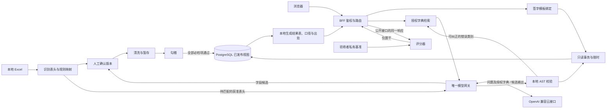

# 江海智造问数 POC 总体设计

OPC 的两人团队要在测试机上验证三件事：同一份经营工作簿能否重导、勾稽并追到源行；财务认可的公式能否在不同问法下稳定复算；超出模板的问题能否在权限范围内用真实模型回答。验收材料是一个已发布批次、可复算的网页答案、一次独立的 40 题盲测和逐步证据。本轮交付到开发文档为止，下面的路径、命令及门槛是给 dsh 的实现契约。

## 范围与正式项目的衔接

演示覆盖 2026Q3 虚拟制造业经营、财务、生产数据。授权以本地演示身份、数据域、密级和动作表示。模板覆盖六个有源字段的指标；长尾支持本批次字典内的分组、比较、排序、比率与清洗诊断。问资料入口返回范围提示。扫描件 OCR、文档检索、真实客户登录、ERP 同步和生产运维放在后续阶段。正式项目接入 RAGFlow 时沿用 BFF 的身份、域、密级、来源和网关接口；OCR 先核验再发布。更换模型只换网关适配器，更换数据源新增映射和勾稽规则。实际回款日期、检验投入数等须向客户取得真实来源再签字。[架构评审](../refs/Codex架构评审报告.md) · [问数调研](../refs/ChatBI问数方案调研.md) · [实现原理](../refs/Text2SQL与SQLBot实现原理.md) · [正式方案背景](../refs/企业知识库-10万初版与升级方案.md)



## 数据流和责任边界

1. 导入者锁定文件 SHA-256。每张表先确定角色、表头路径、单位和物理行号，再决定映射和行类型。规则和模型均只能提议，确认人签认可见的字段、换算和用途。原件只在导入和复核侧可读。
2. 明细保留符号、编码、期间和粒度，报表保留情景、层级与时点。以批次关联财务明细、报表、主数据和清洗审计。勾稽通过后在单个事务切换当前批次。授权视图仅暴露已发布字段。报表精度、取舍和诊断聚合都有源行依据。
3. BFF 先验证身份和范围。模板按本地参数生成，长尾先检索字典，再调用唯一网关。云输入业务字段限于经过过滤的问题和授权元数据。示例 SQL 只作为审核过的无值字典条目。错误纠正使用固定指令类别；候选、错误原文、结果、报表摘录、主数据枚举、明细及审计均留在本地。答案由 SQL 结果、公式、单位、来源、勾稽状态本地组装。
4. 每道评测题通过同一网页后端接口。验收者控制题号、标准答案、评分断言及报告；系统不接收题号、标签或判分反馈。开发阶段的验收用自编问题和可手算的小样本，正式评分前冻结运行资产。

## 技术栈与运行约定

| 部分 | 固定基线 | 本机约定 |
|---|---|---|
| 环境 | Debian 13 x86_64、Python 3.13.5、uv 0.13.9 | 根目录执行，`.venv` 隔离，提交完整 `uv.lock` |
| 加载与数据库 | openpyxl 3.1.5、psycopg[binary] 3.2.9、PostgreSQL 17.12 | 普通用户启动私有 Unix socket，金额用 Decimal/NUMERIC |
| 服务与语义 | FastAPI 0.116.1、Uvicorn 0.35.0、PyYAML 6.0.2、sqlglot 27.8.0、httpx 0.28.1 | 单进程 BFF 同源静态 HTML/CSS/原生 JS；网关单独持密钥 |
| 测试 | pytest 8.4.1、Node 24.22.1/npm 11.21.1 | Node 仅作 JS 检查；实际浏览器操作见步骤 14，记录浏览器版本 |
| 推理 | `https://api3.kkyy.site/v1`，`deepseek-v4.1-flash` | 仅从环境注入 `CHATBI_LLM_API_KEY`，真实调用的可用性在实施时验收 |

Excel 默认单工作簿、单进程顺序扫描，解析与在线问答错峰。POC 设 PostgreSQL shared_buffers 为 64MB，work_mem 为 4MB，连接上限 12；BFF 单 worker，模型并发 1，评测串行。默认期为已发布报表季度；相对时间以批次截止日为锚，响应明确起止日期。UI 绑定 `127.0.0.1:8080`。安装、镜像及运行条件见[风险与假设](风险与假设.md)。

## 实施后的目录

```text
data/                   原始工作簿，只读
docs/steps/             逐步开发与验收契约
pyproject.toml uv.lock  依赖和 chatbi 命令入口
src/chatbi/             ingest/、db/、semantic/、query/、gateway/、api/、cli.py
config/                 profiles/、mapping/、semantic/、templates/、roles.yaml
sql/                    migrations/、reconcile/、views/
web/                    index.html、app.js、style.css
scripts/                bootstrap、pg、serve、demo
tests/                  按步骤命名的测试、独立合成夹具
var/                    pg/、run/、stage/、audit/、approvals/、evidence/（本地生成）
evaluator/              验收侧命令、评分规则解析和对比测试
refs/                   参考资料，仅验收者可将基准交给评分器
private-eval/           验收者持有的答案、运行快照与报告，排除在运行包外
```

单一 CLI 采用 `.venv/bin/chatbi`，下文简写 `chatbi`，先执行 `source .venv/bin/activate`。每次测试从根目录启动。`tests/test_sNN.py` 是该步可交付的测试文件，命名用例见各步。工作簿默认从 `data/江海智造_2026Q3_经营财务模拟数据.xlsx` 读取，`--book` 可替换合成样本。阶段命令默认从 `var/stage/` 解析最近一次**明确选定**的运行清单，报告带文件哈希、规则版本与批次；并发运行显式传 `--run ID`，禁止按目录修改时间选输入。

## 依赖与并行安排

| 步 | 文件 | 依赖 | 合并边界 |
|---|---|---|---|
| 01 | [本机环境](steps/step-01-本机环境.md) | 无 | 锁版本、命令入口、PG |
| 02 | [模型网关](steps/step-02-模型网关.md) | 01 | 可与 03 并行 |
| 03 | [工作簿盘点](steps/step-03-工作簿盘点.md) | 01 | 输出 28 表注册表 |
| 04 | [字段映射](steps/step-04-字段映射.md) | 02、03 | 人工确认后冻结映射 |
| 05 | [明细清洗](steps/step-05-明细清洗.md) | 04 | 提供共享标量解析契约 |
| 06 | [报表与主数据](steps/step-06-报表与主数据.md) | 04、05 的标量接口 | 可与 05 的明细适配并行 |
| 07 | [分批入库](steps/step-07-分批入库.md) | 05、06 | 暂存、授权视图、发布事务 |
| 08 | [勾稽与发布](steps/step-08-勾稽与发布.md) | 07 | 整批发布 |
| 09 | [语义层](steps/step-09-语义层.md) | 07 | 可与 08、10 并行 |
| 10 | [受限查询执行](steps/step-10-受限查询执行.md) | 07 | 合成发布库验权限与解析 |
| 11 | [签字模板](steps/step-11-签字模板.md) | 08、09、10 | 可与 12 并行 |
| 12 | [长尾问数](steps/step-12-长尾问数.md) | 02、08、09、10 | 返回统一结果块 |
| 13 | [路由与权限](steps/step-13-路由与权限.md) | 11、12 | 同一问题可含多个意图 |
| 14 | [接口与网页](steps/step-14-接口与网页.md) | 13 | 页面可预先按响应契约开发 |
| 15 | [隔离评测](steps/step-15-隔离评测.md) | 14 | 验收者可先用假服务开发评分器 |
| 16 | [最终演示](steps/step-16-最终演示.md) | 01–15 | 重启、盲测、复算、交接 |

两人协作时，一人负责导入、批次和勾稽，另一人负责网关、查询和展示。并行者只改自己模块和测试；CLI 子命令由各模块注册，入口和迁移序号由集成人维护。缺真实密钥时可用固定假网关验离线路径，真实长尾和最终盲测另计状态。逐条判定及问题回填见[验收规范](验收规范.md)。
