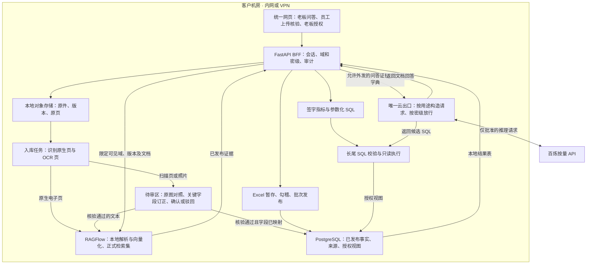

# MLCC 检测治具企业知识库与问数系统独立评审报告

**评审日期：2026-11-24。评审意见：有条件通过，建议修改一期范围和验收条款后签约。**

按客户最新七条需求，原方案的一期设计满足度为 **60.4%**。最影响签约的有三处：扫描件能被检索却没有人工发布关口，关键数字统一走 WrenAI 却缺固定 SQL 模板，销售与质检两张样表支撑不了毛利、应收和回款。把这三处写成验收条款，比增加图表或提高路由准确率更能保障老板拿到可信答案。[客户约束与补充重点](./00-任务说明.md) · [最终方案 §3、§4、§9、§13](./企业知识库-10万初版与升级方案.md)

**我的建议是用 10 万元买一个能上线的窄范围版本。** 保留 RAGFlow、本地 PostgreSQL、统一自建网页和百炼按量推理。一期用六个签字指标的参数化 SQL 加受限长尾问数，交付一套最小 OCR 复核流程。WrenAI 留作可替换的语义层。按一人全职每周五天估算，50 人天至少需要 **10 个净开发周**。如果保留原方案的 15–20 个指标、完整页面和双引擎，并补齐客户已经明确的控制，独立估算为 **61–90 人天，12.2–18 万元**。

## 一、客户需求满足度（重点 B）

下表评的是**原最终方案已经写明的一期交付**。完全、部分、不满足、放到升级包分别按 1、0.5、0、0 计子项分。权重是本次评审判断，按老板使用价值和数据责任分配。第 6 项是客户明确的后续愿望，列出一期交付进度，权重为零。分数表示设计覆盖度，现场通过率需上线前实测。[任务说明](./00-任务说明.md) · [早期需求 E1–E5、D1–D3、B1–B6、A1 及非功能要求](./企业知识库agent需求与架构.md)

| 客户需求 | 原一期判断 | 权重 | 判分依据与主要风险 |
|---|---:|---:|---|
| 1. 问工艺、规格、图纸说明、质检和合同，点击出处核对 | 部分，80% | 20% | 中文提问、切块引用、回原件各 1 分。行业及涉密资料覆盖、引用确实支持答案与无依据拒答各 0.5 分。原验收只检查能否指到正确文件，同一文件可能同时写有不同机型的公差。 |
| 2. 准确问营收、成本、毛利、订单、回款、良率及维度统计 | 部分，50% | 25% | SQL 展示 1 分。业务数据覆盖、长尾 SQL 校验执行、口径和源表追溯各 0.5 分。固定参数化模板 0 分。MDL 描述指标不足以保证每次走同一公式，两张样表也缺成本和收付款事实。 |
| 3. 员工上传，电子文档直入，OCR 对照原图核验后发布 | 部分，50% | 20% | 上传、原生电子件免审检索各 1 分。原图核验、金额/数量/日期/规格纠错确认各 0 分，审核台列在 U1。未审隔离 0.5 分，扫描数字进不了事实表，但未经核验的 OCR 文字仍能进入回答。 |
| 4. 共 5–6 人，老板按域和密级授权，越权拒绝且可追查 | 部分，50% | 15% | 按人按域 1 分，密级强制执行 0 分，撤权覆盖所有读取途径、操作审计各 0.5 分。最终方案按“老板端 5–6 人另加员工”配置。密级可填标签，却未纳入一期授权公式。 |
| 5. 文件、数据库、索引、解析和检索都在本地，只有生成可用云 | 部分，75% | 15% | 存储落地、本地解析检索各 1 分。本地向量化及组件出口控制、问数严格限定外发载荷各 0.5 分。方案保留内存不足时改变 embedding 部署的余地，也只写了默认不传财务明细。 |
| 6. 报价、定时简报/报告、企微/钉钉、ERP/MES、本地模型、图谱 | 放到升级包，一期 0% | 0% | 六类均已安排，分别涉及 U2、U4/U5、U3、U5、U6、U7。符合客户分期意图。U4 的汇总报告尚未逐一承诺早期提出的 Word、Excel、PPT 模板。 |
| 7. 约 10 万开发费，一人用开源与 AI 编程，统一自建前端 | 部分，62.5% | 5% | 费用边界、开源复用加统一 UI 各 1 分。50 天内完成原范围 0.5 分，单人 6–8 周排期 0 分。AI 可加快页面、映射和回归脚本开发，财务签字、真机联调和恢复演练仍占日历时间。 |

**总体计算**为 `80%×20% + 50%×25% + 50%×20% + 50%×15% + 75%×15% + 0%×0% + 62.5%×5% = 60.375%`，四舍五入为 **60.4%**。未经复核的 OCR 发布、越权泄漏、关键指标绕开固定模板，应分别判一期验收失败，不能由其他项目得分抵消。

早期需求中，还需在合同上单独标明以下交付差异。[早期需求 §3–4](./企业知识库agent需求与架构.md) · [v3 §4–5、§11](./企业知识库agent方案-v3.md) · [最终方案 §7、§13–15](./企业知识库-10万初版与升级方案.md)

| 细项 | 原一期状态 | 依据与风险 |
|---|---|---|
| 员工无问答入口，老板使用统一对话页，管理员改授权 | 完全 | 三种角色已有页面设计。上线仍须验证员工直接请求问答 API 会被拒绝。 |
| 文件分类、版本去重、真实进度、失败重试 | 部分 | 有上传、域、标签和失败状态。相同文件重传、旧版作废、混合扫描页重新核验的语义欠缺。 |
| 核验者确认、驳回、改值、留痕，停用切块即时失效 | 放到升级包／部分缺失 | U1 写了字段审核入库。一期没有核验者工作台，也未明确“只做检索”的 OCR 切块何时可发布。 |
| 固定指标模板及版本 | 不满足 | v3 明确双轨，最终时序只列 `generate_sql → 校验 → run_sql`。标准问法偶然答对不能替代模板交付。 |
| 汇总分析、数字来源和原文定位 | 部分 | 有结果表、SQL、切块和原件。缺查询批次到源表行的链路、跨域汇总说明。页内框选归 U4。 |
| 文件夹、行列权限与登录 | 部分／放到升级包 | 初版账密登录和域级授权可用。文件夹、SSO 和更细授权在 U3，客户已明确需要的密级控制应提前。 |
| 审计、备份、可用性和质量评测 | 部分 | 有本地日志、题库、备份说明及一次恢复演练。日志留存、恢复时间、峰值负载、引用支持答案与拒答的统计口径尚待签定。 |

## 二、架构取舍与关键事实核实（重点 A、E）

### 2.1 选哪种组合

**文档和经营数字分两条链路是合理的。就 5–6 人、两类导出表和一人维护的条件，我优先选 RAGFlow 加轻量问数后端。** RAGFlow 解决解析、索引和出处，数据库负责计算。无论选哪个问数产品，财务仍要定义口径，业务后端仍要控制权限、发布和外发。

| 候选 | 适配性及决定 |
|---|---|
| RAGFlow + WrenAI + PostgreSQL + 自建 BFF/UI | 技术上可行。多数据源、复杂关系和指标增多后，WrenAI 的语义层有价值。一期同时引入它会增加模型配置、权限映射、版本和运维工作。经典版与新版的接口、许可和维护状态有实质差异，见下表。 |
| **RAGFlow + PostgreSQL + 参数化模板 + 受限长尾生成 + 自建 BFF/UI** | **推荐一期。** 模板命中后本地绑定参数。长尾只把问题和已授权数据字典发给模型，返回候选 SQL 后本地校验、执行。授权、审计、云出口和结果展示只做一套。 |
| 只用 RAGFlow，或只写 SQL 模板 | 前者能快速交付问资料，但文档切块无法承担跨期营收、回款或加权良率计算。后者可可靠交付签字指标，但覆盖不了客户明确要求的长尾。两者各自单独使用都会缺一条必需链路。 |
| Dify + 数据库工具 | 可编排问答流程，仍要另做审核、SQL 校验、授权视图和统一前端。Dify 许可对多租户和使用其前端时的标识有附加要求，纯后端使用有不同适用条件。这个规模下换平台缺少足够收益。[Dify 许可证](https://github.com/langgenius/dify/blob/main/LICENSE) |
| WorkBuddy + 腾讯乐享 | 可作为办公体验参照。腾讯购买指南列有共享 VPC、专享 VPC 和私有化不同部署形态。前两档与客户机房要求不符，私有化需询价。现有材料不足以证明其能直接验收本项目的 OCR 发布和财务模板控制。私有化成交价及小席位例外未核实。[腾讯购买指南](https://main.qcloudimg.com/raw/document/product/pdf/1831_134331_cn.pdf) · [项目竞品对比](./workbuddy-乐享-对比.md) |

### 2.2 官方版本、许可证、接口及硬件

以下为截至评审日实际取得的官方发布页、版本源码或产品条款。源码能证明某段实现存在，客户环境中的端到端兼容性仍需实测。

| 项目 | 已核实事实 | 对交付的影响 |
|---|---|---|
| RAGFlow 版本与许可 | 官方最新正式发布为 **v1.0.0**，2026-11-06 发布。该标签根许可证为 **Apache-2.0**。[发行记录](https://github.com/infiniflow/ragflow/releases/tag/v1.0.0) · [标签许可证](https://github.com/infiniflow/ragflow/blob/v1.0.0/LICENSE) | 固定标签、镜像摘要、解析配置及模型权重版本。主仓库许可证不能代替所有依赖的许可清单。 |
| RAGFlow 检索、引用与下载 | `POST /api/v1/retrieval` 要求 `dataset_ids`，可用 `document_ids` 限定文档。`POST /api/v1/openai/{chat_id}/chat/completions` 使用该助手的知识配置，`extra_body.reference=true` 返回引用。`GET /api/v1/datasets/{dataset_id}/documents/{document_id}` 下载原件。Dataset 管理权限列为 `me/team`。[v1.0.0 HTTP API](https://github.com/infiniflow/ragflow/blob/v1.0.0/docs/references/http_api_reference.md) | BFF 按当前授权调用检索接口。共享助手的固定知识范围不能承担多用户隔离。授权集合为空直接拒绝，引用和下载重新鉴权。 |
| 页码和坐标 | 官方 HTTP 示例既有五元组，也有空 `positions`、空 `image_id`。同标签前端源码按 `[页码, x1, x2, y1, y2]` 读取。这给出了该版本的实际解释。跨格式、跨解析器均有可用坐标以及稳定的切块截图专用 API **未核实**。[HTTP 示例](https://github.com/infiniflow/ragflow/blob/v1.0.0/docs/references/http_api_reference.md) · [官方前端实现](https://github.com/infiniflow/ragflow/blob/v1.0.0/web/src/utils/document-util.ts) | 一期验收文件版本、切块、原件和可用页码。OCR 复核可人工翻到原页，无须等待自动高亮。 |
| WrenAI 新版 | 官方最新 Release 为 **`wren-v0.18.0`**，2026-11-10 发布。其 LICENSE 按路径列出核心、SDK 等为 Apache-2.0，文档为 CC BY 4.0，AGPL 文本为未来模块预留，商标单列。README 将旧聊天产品列为 GenBI Classic，说明旧线无新增功能或安全修复。[新版发行](https://github.com/Canner/WrenAI/releases/tag/wren-v0.18.0) · [新版 LICENSE](https://github.com/Canner/WrenAI/blob/wren-v0.18.0/LICENSE) · [新版 README](https://github.com/Canner/WrenAI/blob/wren-v0.18.0/README.md) | 新版可评估 CLI、SDK、语义层和 MCP。新版与 Classic 的两个 `/api/v1` 路由可直接互换 **未核实**。 |
| WrenAI 经典版 HTTP 与许可 | 官方旧安装页示例是 **`0.29.2`**。该标签有 `POST /api/v1/generate_sql`、`POST /api/v1/run_sql` 的服务端源码。生成可接 `threadId` 读取历史，可请求原生方言。执行端使用当前项目和已部署的 manifest，`limit` 默认 1000。该标签根 LICENSE 明确为 **GNU AGPL v3**。云端问数指南另列 `/v2/generate_sql`、`/v2/run_sql`。[旧版安装页](https://docs.getwren.ai/oss/installation) · [生成源码](https://github.com/Canner/WrenAI/blob/0.29.2/wren-ui/src/pages/api/v1/generate_sql.ts) · [执行源码](https://github.com/Canner/WrenAI/blob/0.29.2/wren-ui/src/pages/api/v1/run_sql.ts) · [旧版 LICENSE](https://github.com/Canner/WrenAI/blob/0.29.2/LICENSE) · [云端指南](https://wrenai.readme.io/reference/cloud_sql_generation) | 原方案混用了旧接口与新许可。采用旧版需按实际分发、修改和网络使用方式复核义务。若试新版，先验证生成的最终 PostgreSQL 方言、外发请求、权限隔离和升级回归。一期无需承担旧线维护。 |
| 32 GB、无 GPU | RAGFlow 官方**建议起步**为 4 核、16 GB RAM、50 GB 空闲磁盘，Docker ≥24、Compose ≥2.26.1。1.0 开源 Go DeepDoc 的版面、OCR、表格识别走 CPU。Compose 还涉及搜索引擎、元数据库、对象存储等。WrenAI 旧安装页列 Docker Desktop 4.17+。本项目整栈的官方内存下限、OCR 页/分钟及六人响应时间 **未核实**。[RAGFlow 起步配置](https://ragflow.io/docs/) · [DeepDoc FAQ](https://ragflow.io/docs/faq) · [版本部署清单](https://github.com/infiniflow/ragflow/blob/v1.0.0/docker/docker-compose-base.yml) · [WrenAI 安装说明](https://docs.getwren.ai/oss/installation) | 32 GB 可做真机试点。OCR、向量化与查询同机争 CPU、内存和磁盘。先开一个解析任务，批量建库错峰。压测后再决定降低并发、停用可选重排或扩内存。 |
| 对象存储 | RAGFlow v1.0.0 Compose 中，服务名 `minio` 指向 `pgsty/silo` 镜像。原 MinIO 社区仓库在核查时标为 archived，根许可为 AGPLv3。[Compose](https://github.com/infiniflow/ragflow/blob/v1.0.0/docker/docker-compose-base.yml) · [MinIO 仓库状态](https://api.github.com/repos/minio/minio) · [MinIO LICENSE](https://github.com/minio/minio/blob/master/LICENSE) | 合同写“本地 S3 兼容对象存储”，交付清单列实际镜像、许可证、备份与维护责任。业务原件和审核页图用独立桶和凭据，避免再装一套同类服务。 |
| Ant Design X 与 ECharts | `@ant-design/x@2.9.0` 是 **MIT**，其包声明要求 `antd ^6.1.1`、React/React DOM ≥18。Apache ECharts **5.6.0 是 Apache-2.0**。原方案“均为 MIT”和“Ant Design 5 或 6 随选”均需修订。[Ant Design X LICENSE](https://cdn.jsdelivr.net/npm/@ant-design/x@2.9.0/LICENSE) · [包依赖](https://cdn.jsdelivr.net/npm/@ant-design/x@2.9.0/package.json) · [ECharts LICENSE](https://github.com/apache/echarts/blob/5.6.0/LICENSE) | 前端锁相容版本，保留适用版权、许可证和 NOTICE。一期结果表已够用，图表可后移。 |

### 2.3 百炼条款与数据外发边界（重点 E）

**补充重点 E 中的引文有厂商归属错误。** “除与您另有书面约定外……可能将通过开放平台提交的输入和输出用于开发、训练、评估及改进模型”可在 **DeepSeek 开放平台隐私政策第七章第 2 项**找到。阿里云百炼《合规资质与隐私说明》写的是“绝不会将您的数据用于模型训练”，同时写明依法存储模型与应用调用时产生的数据。客户实际订单的具体留存天数、删除时限、地域及人员访问安排**未核实**。[DeepSeek 开放平台隐私政策](https://cdn.deepseek.com/policies/zh-CN/deepseek-open-platform-privacy-policy.html) · [百炼合规资质与隐私说明](https://help.aliyun.com/zh/model-studio/privacy-notice)

**套餐和实际推理服务商都要核对。** 百炼服务协议第 5.2.2 条对 Token Plan 个人版和 Coding Plan 的输入输出另有服务改进与模型优化授权。第 5.3 条规定，云市场第三方推理服务另适用相应供应商协议。建议一期使用客户名下的百炼按量 API，指定阿里云提供推理的模型、地域和端点，留存对应协议版本。若改用适用“可能用于训练”条款的服务商，真实业务内容启用前取得书面排除，或转为本地检索和模板问数。[百炼服务协议 §5.2–5.3](https://terms.alicdn.com/legal-agreement/terms/common_platform_service/20230728213935489/20230728213935489.html) · [Token Plan 产品范围](https://help.aliyun.com/zh/model-studio/token-plan-user-guide/)

**建议执行策略。** 文档问答只发允许外发的问题和最少量的已授权、已发布切块。问数只发问题和该用户可见的字典，真实样例值、结果行、汇总、数据库报错和含数字的历史对话均留在本地。问题本身也可能含客户名、合同号和金额，应先做本地策略检查。最高密级只返回有权的本地检索结果和原件，云中断时仍可运行固定 SQL。解析、embedding、重排在本地，只有网关持云密钥并允许出站。用测试标记和本地模拟端点检查解密后的请求体，再核对真实出口目的地，仅看 HTTPS 抓包看不见正文。数据离开厂区和跨境传输需按实际地域分别判断。

## 三、修正后的架构与数据责任

1. **先隔离，再发布。** 原生电子文档直接检索。混合 PDF 按页识别，无法可靠拆分的整件待审。OCR 草稿和生产索引分开，员工能看原页、改值、标记无法辨认、确认或退回。批准记录绑定文件版本、审核人和时间。索引失败可重试，发布状态与正式查询可见性保持一致。换版、撤回和删除同时影响引用、下载和检索。
2. **权限执行到对象和历史。** 用“用户有权的数据域 ∩ 密级上限 ∩ 有权执行的动作”算权限。少量域和两档密级可预分数据集。上传者只看获授权的任务，核验者按域审。读取会话、原件、引用、导入报告和缓存时均按当前授权重查。查询许可和向云发送许可分别计算，已撤权用户重新打开旧会话时屏蔽相关内容。
3. **可信数字从导入开始。** 最终方案的 `doc_no` 可空，同一单也可能有多行，按单号跳过或覆盖会漏算。建议暂存后以源系统、单号与行号或双方确认的业务键去重，记录文件哈希、批次、表页和行号，整批事务发布，重复导入结果不变。财务签认税口径、币种、退货负数和确认期间。跨批良率按总合格数除以总投入数计算，并约定零分母处理。销售额能否作为收入取决于确认口径，毛利需要成本，应收和回款需要相应余额或收款流水。[最终方案 §9](./企业知识库-10万初版与升级方案.md)
4. **执行经过校验的最终 SQL。** 固定指标走带版本的参数化模板，日期、组织、产品线等使用绑定参数。长尾用 PostgreSQL 方言解析 SQL 语法树，只接受单条受限查询，递归检查引用的视图、列和函数。数据库账号仅可读授权视图，设置只读事务、行数、超时和并发上限。校验和执行同一条最终 SQL，连接池归还时清除身份上下文。拒绝和无数据在界面区分。结果带口径、参数、批次、更新时间和 SQL。[PostgreSQL 视图与调用者权限文档](https://www.postgresql.org/docs/16/sql-createview.html)
5. **按治具行业验引用。** 保留客户、设备机型、治具类别、料号、图号、修订版、单位和适用日期。封端载板与分选转盘要能区分。提到“0402”时应识别英制和公制两套代码，信息不足就追问。把旧版指导书排在首位，即使文件名相似也应计错。[行业报告 §2、§4](./mlcc-检测治具行业入门报告.md) · [村田尺寸代码说明](https://article.murata.com/zh-cn/article/basics-of-capacitors-6) · [最初调研 §5](./企业知识库agent方案调研.md)

## 四、10 万元一期的范围、工期与验收（重点 C）

### 4.1 范围和技术栈

| 决定 | 建议写入合同的范围 |
|---|---|
| **必须做** | 共 5–6 个用户，同一网页按角色展示。先开工艺、质检、经营三个域和两档密级。支持 PDF、DOCX、约定照片和两种 Excel 导出。原生文档直接检索，OCR 逐件对照原页并核验四类关键字段。问资料给出处及原件。问数字给签字口径、SQL 与来源。所有读取、授权、发布、拒绝及调云可追查。 |
| **可以简化** | 一种固定扫描质检表支持核验后写事实表，其余约定扫描件核验后供检索。财务问数先用电子导出，勾稽异常退回。六个有源字段的指标按期验收，可从月营收、销量、投入数、合格数、不良数、加权良率中选定。客户/产品统计以源表维度为准。精简为表格、同页引用、手动选择问资料/问数字，少量明确规则辅助切换。 |
| **必须砍掉或后移** | 任意扫描财报自动结构化、通用字段框编辑和多级审批、15–20 个未签字指标、漂亮图表、自动路由准确率承诺、页内精确高亮、Office 输出、报价、定时报送、直连 ERP、本地生成模型及图谱。若成本、毛利或回款是上线必需项，先换入对应导出和模板，再等量换出其他指标。 |
| **选用技术** | React 18 + Ant Design 6 相容版本 + Ant Design X、FastAPI、PostgreSQL 16、RAGFlow v1.0.0、同机 S3 兼容存储、本地 CPU embedding、SQL 语法树解析库、Docker Compose。入库用单个后台工作进程。原件、应用元数据、索引和审计均落本地。 |

### 4.2 人天与报价

**原文事实。** 最终报价表八项相加确为 50 人天，假设 2,000 元/天，合计 10 万元。硬件、云费、差旅另计。v3 全量估算 130–210 人天，假设约两名工程师和半名项目经理，含更完整的审核、双轨问数、出站控制与试点加固。最终方案删除审核台，却仍承担自建 UI 和双产品集成。[最终方案 §11–12](./企业知识库-10万初版与升级方案.md) · [v3 §11](./企业知识库agent方案-v3.md)

| 工作项 | 原报人天 | 保留原广度并补齐必需能力，独立估算 | 推荐窄范围，独立估算 |
|---|---:|---:|---:|
| 样本、口径、权限矩阵、验收题 | 5 | 5–7 | 4 |
| 真机部署、组件验证、锁版 | 5 | 5–8 | 5 |
| Excel 导入、勾稽、幂等与追溯 | 5 | 6–9 | 5 |
| 指标模板、长尾问数、SQL 校验 | 6 | 9–13 | 7 |
| 文档入库、引用、最小 OCR 核验 | 3 | 7–11 | 6 |
| BFF、授权、出口控制、审计 | 8 | 9–13 | 7 |
| 统一前端与复核交互 | 12 | 10–14 | 6 |
| 回归、恢复演练、交接培训 | 6 | 7–10 | 6 |
| 现场差异和返工余量 | 0 | 3–5 | 4 |
| **合计** | **50** | **61–90** | **50** |
| **按 2,000 元/天计开发费** | **10 万元** | **12.2–18 万元** | **10 万元** |

**报价判断。** 一人连续工作 6–8 周仅有约 30–40 个工作日。窄范围按 **10 个净开发周，日历约 10–12 周**估算，前提是客户按时提供样本、测试主机和签字人。客户侧备数与复核单列。硬件和云费按客户实际采购、调用结算。云费可用一周账单按实际老板提问量外推，原方案按六名问答用户估算的月费未验证。付款可沿用 30% 启动、40% 双链路联调、30% 验收，联调节点加入“未审不可见”和“无权不可读”。

### 4.3 一人分周计划

| 周 | 可检查的成果 |
|---|---|
| 1 | 老板确认人员和权限，财务及质量负责人给近三个月样例、源表和标准答案。冻结六个指标、一个扫描表型、支持格式和容量。 |
| 2 | 在客户 32 GB 无 GPU 主机跑通一份电子件、一份扫描件和一次百炼调用。保存镜像清单、引用样例、内存峰值和实际出口载荷。 |
| 3 | 跑通两份 Excel 导出的暂存、勾稽、来源行定位、重传和整批回滚。 |
| 4 | 原生文档分域发布，员工能跟踪进度、查看失败原因并重试，老板能点引用回原件。 |
| 5 | 扫描件原页对照、关键字段订正、驳回、重新提交、批准发布和撤回走通。 |
| 6 | 财务核对固定模板、绑定参数、维度和口径版本，用手算或源系统报表对账。 |
| 7 | 受限长尾生成、SQL 校验、数据库最小权限和云网关联调，测试歧义提问和拒绝。 |
| 8 | 统一工作台成型，贯通上传、审核、授权、历史、下载与本地审计。 |
| 9 | 工艺和财务人员盲测，执行混合负载、越权、断网降级和备份恢复测试。 |
| 10 | 消化返工余量，重跑未通过题，交付管理员手册、版本及许可证清单、恢复记录和培训。 |

### 4.4 建议验收标准

以下数字为**建议签约目标，尚未实测**。第 1 周冻结题库、样本和计算方法，保留未参与调试的题目。题库中的高分不能抵消单项权限或发布错误。

| 验收项 | 方法和通过标准 |
|---|---|
| 文档与引用 | 30 道有答案题，含同名不同机型、旧版本、扫描件。首条引用命中正确版本至少 26/30，人工核对引用支持关键结论至少 27/30。再加 10 道缺证据或规格含糊题，至少 9/10 正确拒答或追问。每个已展示引用均能按权限回原件。 |
| OCR 与数据发布 | 10 份约定扫描件或照片覆盖金额、数量、日期、规格及混合 PDF。逐一对照原页。未审、驳回、作废版本在检索和 SQL 中均为 0 条，审批留痕完整。已确认字段逐项与人工真值一致，无法辨认项必须显式挂起。原生电子文档通过解析即可检索。 |
| 问数与勾稽 | 六个签字指标，每个用两种问法，12/12 命中固定模板并与财务或质量源表一致。核对期间、币种、税、退货及零分母。另用 20 道锁定的范围内长尾题，建议至少 16 道结果一致，拒答计未答对。超范围问题明确说明。重复导入不变，错误合计整批拒绝，结果可追到源批次。 |
| 权限与出站 | 至少 12 个反例覆盖跨域、跨密级、对象下载、历史会话、撤权、导入报告、SQL、OCR 草稿和高密问题。越权泄漏 0 次。网关以可审阅载荷证明问数仅发问题与授权字典，结果和测试敏感标记外发 0 次。最高密级、云故障均按约定降级。 |
| 性能与恢复 | 在客户主机分开测空闲、单任务 OCR、3 人同时查询和 6 个账号的实际混合负载。记录解析页/分钟、队列等待、整答 P95、内存峰值、交换和磁盘增长。建议起谈目标为上传状态 1 分钟内可见、常用模板 P95 ≤3 秒、文档整答 P95 ≤15 秒，按第 2 周真机结果定稿。连续混合负载 1 小时无内存耗尽或丢任务。每日备份，隔离恢复一次，抽查原件、权限、批次、审核与索引一致。 |

## 五、二期扩展与报价（重点 D）

一期只为二期保存稳定标识和可替换的接口，不提前部署额外平台。文件保留 `file_id`、`version_id`、源页、可空坐标、域、密级和发布状态。事实保留业务键、来源批次、审批记录。指标保留版本、单位、维度、负责人和模板。用稳定的内部用户 ID 映射未来的企微或钉钉身份。统一封装检索、查数、取原件、发布和模型调用。Web、未来机器人和定时任务都经同一套授权。解析进程和生成端点可独立换机，备份涵盖原件、业务库、引擎配置及索引或可验证的重建材料。

下表为**增量估算**，按 2,000 元/人天折算，基于上文已有最小核验、密级和模板的初版。硬件、商业许可、外部系统接口费另计，各包有共享工作，不宜直接相加作为总合同价。[最终方案 U1–U7 原范围与估算](./企业知识库-10万初版与升级方案.md)

| 优先时机 | 升级及一期接口如何复用 | 人天／开发费估算 |
|---|---|---:|
| 扫描单据经常进入问数 | **U1 增强 OCR**，在既有审核记录上叠加多表型、自动框选、按字段置信度分派与多人复核。 | 12–25／2.4–5.0 万 |
| 账号或授权维护开始费时 | **U3 企微/钉钉与细权限**，通过身份映射接 SSO，扩展文件夹、行列权限，机器人继承相同授权。 | 8–16／1.6–3.2 万 |
| 人工导出阻碍日查数 | **U5 ERP/MES 与定时简报**，只读连接器写入同一暂存、对账、发布流程。定时任务按接收人重新授权。邮件简报可先上，企微投递再接 U3。 | 12–25／2.4–5.0 万 |
| 积累足够历史成交、图纸和工时 | **U2 报价草稿**，复用有权限的图纸版本与相似件检索，另建工序、成本规则和审批记录，由技术人员确认后发布。 | 10–20／2.0–4.0 万 |
| 例会有固定模板 | **U4 页内定位及报告**，将已验证坐标接入预览，以现有证据、查询快照和模板生成报告。按实际需要锁定输出格式。 | 10–18／2.0–3.6 万 |
| 高密资料必须生成答案 | **U6 本地生成模型**，沿用外发政策和模型网关，换本地推理端点，单独测质量和并发。硬件需询价。 | 8–15／1.6–3.0 万 |
| 普通检索反复答错跨机型关系 | **U7 知识图谱**，用客户、机型、治具和工艺稳定标识构建关系，边保留来源版本和可见范围。 | 10–20／2.0–4.0 万 |

## 六、签约前最值得客户确认的五个问题

1. **老板最先要靠哪六个数字做决定？** 请财务和质量负责人逐项给出源表、公式、期间、维度和一个标准答案。若毛利或回款必须首发，哪份真实导出能补上成本或收款，替换掉哪个原定指标？
2. **现场最常见的扫描件是什么，谁能签字发布？** 用真实照片、混合 PDF 和手写改动样张确定首个表型、每日页量、四类关键字段，以及无法辨认、驳回重传和纠错后的处理方式。
3. **这 5–6 个人分别能上传、核验、查询、下载哪些域和密级？** 请老板用一份矩阵给出真实反例，包括谁只看汇总、谁可看经营明细、谁能调低密级，以及授权撤回后的历史读取规则。
4. **哪些内容获准发到哪一个推理端点？** 请分别确认工艺片段、合同、核心图纸、用户问题及字典的外发范围，百炼账号、模型供应主体、地域、留存条件，以及最高密级只在本地展示检索结果是否够用。
5. **10 万元最不能牺牲的是哪些验收结果？** 请用目标服务器配置、真实样本量、并发、可接受等待时间、备份恢复目标和负责人可用时间，确认 10 个净开发周及范围置换规则。客户资料迟到或指标必须扩充时，明确调整哪项交付或哪一里程碑。

**核实边界。** 版本、接口源码、坐标处理、许可证和公开云条款已按正文链接核查。原方案和前序材料反映的是拟交付承诺。报告中的满足度权重、六指标范围、人天、周计划、升级价格和验收阈值均为独立评审建议。客户机房性能、真实样本准确率、全部依赖的再分发义务及实际云订单条款仍须在选定交付版本和客户环境中验证。
