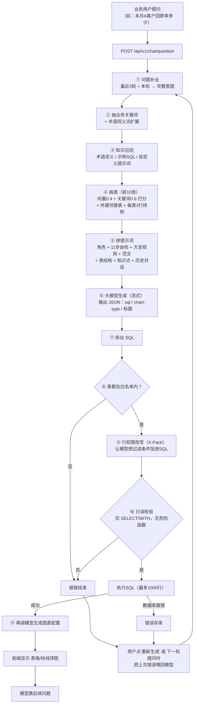
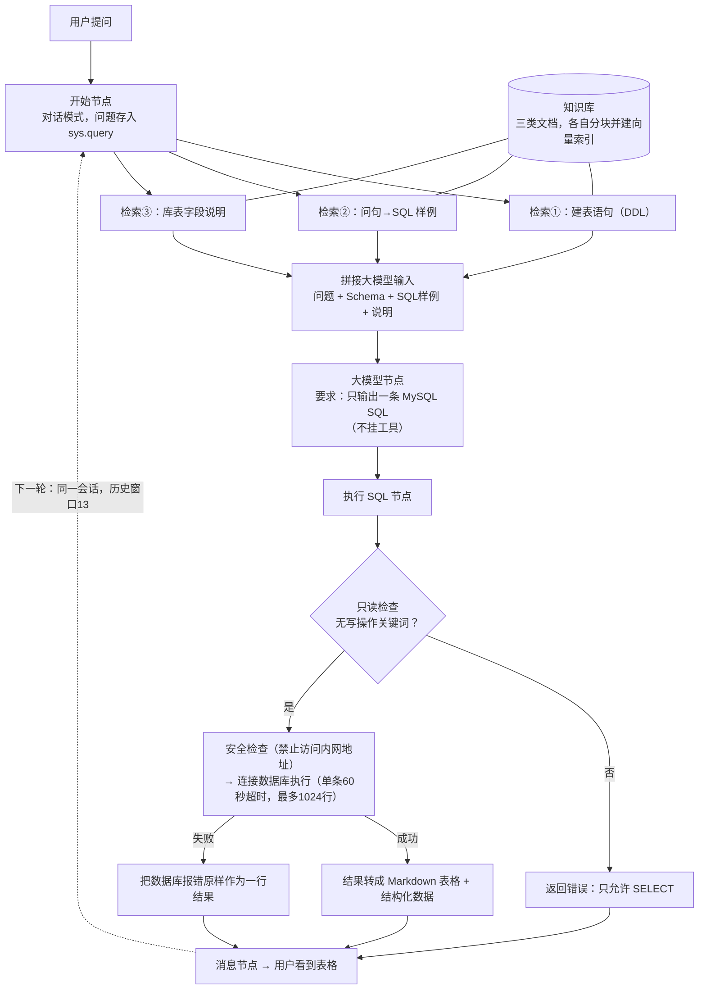

# SQLBot 与 RAGFlow Text2SQL 实现原理调研（面向业务负责人）

> 调研日期：2026-11-24 ｜ 笔者：助理整理 ｜ 交付对象：不懂代码的老板 / 项目决策人
>
> 两个仓库均已在本地 `git clone --depth 1` 后逐文件阅读源码，方法是“源码为准，官方文档为辅”，每条结论都标了来源；源码引用均写成可点击的 GitHub 链接（路径 + 行号）。
>
> - **SQLBot**：https://github.com/dataease/SQLBot ，基线 commit `dd12090a70859103fcdf07cdad2052dcb23328bc`（2026-11-23 快照）。源码链接形如 `backend/apps/chat/task/llm.py#L12`（仓库内路径 + 行号），点击即跳到该 commit 对应的 GitHub 文件。
> - **RAGFlow**：https://github.com/infiniflow/ragflow ，标签 `v1.0.0`，commit `db1cd5929a7885a3074547791f5ecc4d2f891739`。源码链接形如 `internal/agent/tool/exesql.go#L12`（仓库内路径 + 行号），点击即跳到 v1.0.0 对应的 GitHub 文件。
> - 查不到、或源码与文档对不上的地方，一律写“**未核实**”，不猜。

---

## 目录

1. 先看结论（一页版）
2. 用大白话讲 Text2SQL 是什么
3. SQLBot：它是怎么实现的
   - 3.1 系统构成
   - 3.2 整体流程（一次提问走完的 11 步）+ 流程图
   - 3.3 上下文如何准备（实施方要配什么、存在哪、怎么被检索）
   - 3.4 安全
   - 3.5 支持的数据库与 Excel/CSV
   - 3.6 对接方式（能不能被我们自建的 FastAPI BFF 调用）
   - 3.7 许可证要点
   - 3.8 优缺点
4. RAGFlow v1.0.0 的 Text2SQL：它是怎么实现的（结构同上）
5. 两者对比表
6. 对“MLCC 小厂：6 个签字指标参数化模板 + 长尾问数”项目的借鉴
7. 结论
8. 附：核实清单（核实了什么、哪些未核实）

---

## 1. 先看结论（一页版）

| 问题 | SQLBot | RAGFlow v1.0.0 |
|---|---|---|
| 它是什么 | 一个**独立的“对话式 BI”产品**：自带前端、后端、元数据库、元数据同步工具 | **不是独立产品**，是 RAGFlow 大平台里的一个**内置 Agent 模板**（画布），加上一个“执行 SQL”组件和几个知识库检索节点 |
| 适合谁用 | 想让业务同事直接“问数”、不想自己写前端 | 已经用 RAGFlow 做知识库/Agent，想顺手加一个问数能力，或想用可视化画布自己拼流程 |
| 上下文检索 | 表结构**按相关度筛选**（向量+关键词混合，取前 10 张表），术语、示例 SQL 用“字面匹配 ∪ 向量召回” | 三路**知识库检索**（建表语句 / 问句-SQL 样例 / 库表说明），每路取前 8 条，关键词与向量按 0.7:0.3 混合 |
| 纠错重试 | **没有自动重试**；SQL 执行失败的错误会存下来，用户下一次提问时再喂回给模型 | **模板里没有**任何重试或校验回环，执行失败直接把报错显示给用户 |
| 只读保护 | 代码层面拦截（只允许 SELECT/WITH + 危险函数黑名单 + 表白名单） | 代码层面拦截（逐词扫描，禁止任何写操作关键词 + 禁止可执行注释） |
| 行/列权限 | 能力存在，但代码在**闭源 X-Pack** 里 | **开源版没有** |
| 许可 | **修改版 GPLv3**（不得改 Logo/版权；衍生作品需遵守 GPLv3）+ 闭源 X-Pack | **标准 Apache-2.0**，无附加限制 |
| 能否给自建 FastAPI BFF 调用 | 能：REST + SSE、API Key、MCP（JSON）；也能 iframe 嵌入 | 能：`POST /api/v1/agents/chat/completions`（native / OpenAI 兼容），Python SDK，iframe 嵌入 |

**一句话**：SQLBot 是一套“做得很完整、但规则全写死在提示词里、关键能力收在闭源包里”的成品问数系统；RAGFlow 的 Text2SQL 是“一个能跑通演示、但生产上还缺一环（纠错、权限、表白名单）的模板”。两者对你们项目的价值都不在“直接用”，而在**照抄它们的上下文组织方式和安全校验层**。

---

## 2. 用大白话讲 Text2SQL 是什么

数据库听不懂人话。Text2SQL 就是找一个“翻译员”（大模型），把“上个月哪个客户的回款率低于 80%”翻译成数据库能懂的 SQL 查询语句，再去数据库里查，把结果用表格或图展示出来。

翻译要翻得准，关键在于**先给翻译员足够的“参考资料”**：

- **表结构（schema）**：库里有哪些表、哪些字段、字段是什么类型、字段注释写的是什么；
- **表关系**：哪张表和哪张表用哪个字段关联（比如“订单表.客户ID = 客户表.客户ID”）；
- **术语/口径**：“回款率”怎么算？“良率”的口径是什么？——这是财务、质量类指标最容易出错的地方；
- **示例 SQL**：“如果有人问这类问题，应该这样写 SQL”，相当于给翻译员看范文；
- **规则**：只能用 MySQL 语法、只能查不能改、表名要一字不差等。

所以两套方案的差别，本质上就是：**参考资料怎么准备、按什么规则挑选（是全给还是只给相关的）、给了之后怎么检查翻译员写得对不对、写错了怎么办**。下面分别拆开讲。

---

## 3. SQLBot（飞致云 dataease/SQLBot）

### 3.1 系统构成

SQLBot 是一个“开箱即用”的完整产品，装机后浏览器里就是一个聊天界面：

- **后端**：Python 3.11 + FastAPI + SQLModel（SQLModel 是数据库表结构的定义方式），主要业务在 `backend/apps/` 下（[backend/AGENTS.md#L35-L48](https://github.com/dataease/SQLBot/blob/dd12090a70859103fcdf07cdad2052dcb23328bc/AGENTS.md#L19-L22)）。
- **前端**：Vue 3 + TypeScript + Element Plus（[AGENTS.md#L40](https://github.com/dataease/SQLBot/blob/dd12090a70859103fcdf07cdad2052dcb23328bc/AGENTS.md#L20)）。
- **自带数据库**：内置 PostgreSQL 17 + pgvector（向量数据库扩展），用来存自己的配置、会话记录和“向量”（[Dockerfile-base](https://github.com/dataease/SQLBot/blob/dd12090a70859103fcdf07cdad2052dcb23328bc/Dockerfile-base)，迁移中 `CREATE EXTENSION vector`）。
- **图表渲染小服务**：Node 写的 `g2-ssr/`，把图表配置渲染成 PNG 图片（给 MCP、Markdown 场景用）（[AGENTS.md#L41](https://github.com/dataease/SQLBot/blob/dd12090a70859103fcdf07cdad2052dcb23328bc/AGENTS.md#L22)）。
- **闭源商业包 `sqlbot-xpack`**：是**必装依赖**（[backend/pyproject.toml#L43](https://github.com/dataease/SQLBot/blob/dd12090a70859103fcdf07cdad2052dcb23328bc/backend/pyproject.toml#L43)），后端启动时就加载它，缺了起不来（[docs/agents/xpack.md#L9-L14](https://github.com/dataease/SQLBot/blob/dd12090a70859103fcdf07cdad2052dcb23328bc/docs/agents/xpack.md#L9-L14)）。
- **模型**：通过 OpenAI 兼容接口调用任何大模型（云端或本地 Ollama/vLLM 均可，具体接入方式以其“AI 模型配置”模块为准，[backend/apps/ai_model/](https://github.com/dataease/SQLBot/blob/dd12090a70859103fcdf07cdad2052dcb23328bc/backend/apps/ai_model/)）。

### 3.2 整体流程

#### 3.2.1 一次提问从入口到出图，走了哪些步骤

入口是 `POST /api/v1/chat/question`（[backend/apps/chat/api/chat.py#L251-L257](https://github.com/dataease/SQLBot/blob/dd12090a70859103fcdf07cdad2052dcb23328bc/backend/apps/chat/api/chat.py#L251-L257)，`question_answer` 在 `#L253`），后续全部逻辑收在一个“问数任务”里（`LLMService.run_task`，[backend/apps/chat/task/llm.py#L1481-L1799](https://github.com/dataease/SQLBot/blob/dd12090a70859103fcdf07cdad2052dcb23328bc/backend/apps/chat/task/llm.py#L1481-L1799)）：

1. **读懂这一句**：把最近几轮（默认 3 轮，可配置）的用户问题加上本轮问题交给模型，让它输出“这一轮真正的完整意思”（例如用户说“那去年呢？”，模型补成“查询去年各客户的回款率”）。失败就用原问题（[llm.py#L430-L515](https://github.com/dataease/SQLBot/blob/dd12090a70859103fcdf07cdad2052dcb23328bc/backend/apps/chat/task/llm.py#L430-L515)，配置 [backend/common/core/config.py#L114](https://github.com/dataease/SQLBot/blob/dd12090a70859103fcdf07cdad2052dcb23328bc/backend/common/core/config.py#L114)）。
2. **抽关键词**：从“完整意思”里抽出业务词（“本月”“帮我查”这类会被丢掉），再用术语库的同义词扩展（比如“回款率”也匹配“收款比率”）（[llm.py#L551-L570](https://github.com/dataease/SQLBot/blob/dd12090a70859103fcdf07cdad2052dcb23328bc/backend/apps/chat/task/llm.py#L551-L570)）。
3. **召回三类“知识”**：术语（定义口径）、示例 SQL（范文）、自定义提示词（实施方写的额外要求）（[llm.py#L368-L549](https://github.com/dataease/SQLBot/blob/dd12090a70859103fcdf07cdad2052dcb23328bc/backend/apps/chat/task/llm.py#L368-L549)）。
4. **挑表**：从已勾选的表里按“相关度”挑前 10 张（详见 3.3.3），再自动补上通过外键关联的“邻接表”，并可附上每张表 3 行样例数据（[llm.py#L651-L689](https://github.com/dataease/SQLBot/blob/dd12090a70859103fcdf07cdad2052dcb23328bc/backend/apps/chat/task/llm.py#L651-L689)；[backend/apps/datasource/crud/datasource.py#L590-L710](https://github.com/dataease/SQLBot/blob/dd12090a70859103fcdf07cdad2052dcb23328bc/backend/apps/datasource/crud/datasource.py#L590-L710)）。
5. **拼提示词**：把系统角色、11 步自检清单、规则、方言规则、范文、表结构、知识点、历史对话、本轮问题拼成一大段（模板在 [backend/templates/template.yaml](https://github.com/dataease/SQLBot/blob/dd12090a70859103fcdf07cdad2052dcb23328bc/backend/templates/template.yaml)，826 行）。
6. **模型流式生成**：模型被要求**只回一段 JSON**，包含 SQL、图表类型（表格/柱状/条形/折线/饼图）、会话标题、涉及的表名（[backend/templates/template.yaml#L184-L195](https://github.com/dataease/SQLBot/blob/dd12090a70859103fcdf07cdad2052dcb23328bc/backend/templates/template.yaml#L184-L195)）。
7. **拆 JSON**：从回复里抽出 SQL 和表名（[llm.py#L1251-L1281](https://github.com/dataease/SQLBot/blob/dd12090a70859103fcdf07cdad2052dcb23328bc/backend/apps/chat/task/llm.py#L1251-L1281)）。
8. **表白名单校验**：用专门的 SQL 解析库（sqlglot）把 SQL 真正解析一遍，取出它用到的表，必须都在“允许的表”里，否则报错（[llm.py#L1581-L1594](https://github.com/dataease/SQLBot/blob/dd12090a70859103fcdf07cdad2052dcb23328bc/backend/apps/chat/task/llm.py#L1581-L1594)）。
9. **行权限改写（如启用）**：普通用户会被插入行级过滤条件，做法是**再让模型把过滤条件写进 SQL**（见 3.4.3）。
10. **执行**：执行前再做一次“只读校验”（只允许查询类语句、禁止危险函数），然后连数据库取数，结果最多保留 1000 行（[llm.py#L1410-L1417](https://github.com/dataease/SQLBot/blob/dd12090a70859103fcdf07cdad2052dcb23328bc/backend/apps/chat/task/llm.py#L1410-L1417)；[backend/apps/db/db.py#L880-L886](https://github.com/dataease/SQLBot/blob/dd12090a70859103fcdf07cdad2052dcb23328bc/backend/apps/db/db.py#L880-L886)）。
11. **出图 + 猜追问**：再调一次模型，让它根据 SQL 和结果列生成图表配置（横轴、纵轴、系列）；另有一个接口让模型猜用户接下来可能问的问题（[llm.py#L1209-L1249](https://github.com/dataease/SQLBot/blob/dd12090a70859103fcdf07cdad2052dcb23328bc/backend/apps/chat/task/llm.py#L1209-L1249)、[llm.py#L1692-L1716](https://github.com/dataease/SQLBot/blob/dd12090a70859103fcdf07cdad2052dcb23328bc/backend/apps/chat/task/llm.py#L1692-L1716)；[backend/templates/template.yaml#L604-L635](https://github.com/dataease/SQLBot/blob/dd12090a70859103fcdf07cdad2052dcb23328bc/backend/templates/template.yaml#L604-L635)）。

界面上，前端通过**流式推送（SSE）**一步步显示：先是“正在生成 SQL”、再显示格式化后的 SQL、然后“执行成功”、最后出现图表（[llm.py#L1540-L1739](https://github.com/dataease/SQLBot/blob/dd12090a70859103fcdf07cdad2052dcb23328bc/backend/apps/chat/task/llm.py#L1540-L1739)）。

#### 3.2.2 流程图



> 图注：“重新生成”和“把上次错误喂回”是**用户触发**的，不是系统自动重试（见 3.2.4）。

#### 3.2.3 提示词长什么样

SQLBot 的提示词是这套方案最核心也最“重”的资产，全部集中在 [backend/templates/template.yaml](https://github.com/dataease/SQLBot/blob/dd12090a70859103fcdf07cdad2052dcb23328bc/backend/templates/template.yaml) 和各数据库方言文件 `[backend/templates/sql_examples/](https://github.com/dataease/SQLBot/blob/dd12090a70859103fcdf07cdad2052dcb23328bc/backend/templates/sql_examples/)*.yaml` 里。结构大致是：

- **角色**：“你是智能问数小助手……根据给定的表结构和用户问题生成 SQL、标题、图表类型、用到的表名”（[backend/templates/template.yaml#L121-L136](https://github.com/dataease/SQLBot/blob/dd12090a70859103fcdf07cdad2052dcb23328bc/backend/templates/template.yaml#L121-L136)）。
- **11 步自检清单**：分析问题 → 生成基础 SQL → **逐字核对表名/字段名是否在表结构中出现** → 检查行数限制是否在最外层 → 套用其他规则 → 检查语法是否符合该数据库 → 选图表类型 → 定标题 → 生成 JSON → 检查 JSON → 返回（[backend/templates/template.yaml#L56-L69](https://github.com/dataease/SQLBot/blob/dd12090a70859103fcdf07cdad2052dcb23328bc/backend/templates/template.yaml#L56-L69)）。
- **核心规则**：只能生成查询、不许编造表、标识符逐字一致（包括繁简体和大小写，[backend/templates/template.yaml#L152-L170](https://github.com/dataease/SQLBot/blob/dd12090a70859103fcdf07cdad2052dcb23328bc/backend/templates/template.yaml#L152-L170)）、必须返回 JSON、**默认最多 1000 行且必须加在最外层**（[backend/templates/template.yaml#L70-L90](https://github.com/dataease/SQLBot/blob/dd12090a70859103fcdf07cdad2052dcb23328bc/backend/templates/template.yaml#L70-L90)）、多表查询必须给字段加表名前缀（[backend/templates/template.yaml#L107-L120](https://github.com/dataease/SQLBot/blob/dd12090a70859103fcdf07cdad2052dcb23328bc/backend/templates/template.yaml#L107-L120)）、图表类型规则（趋势用折线、对比用柱/条、占比用饼图）（[backend/templates/template.yaml#L192-L213](https://github.com/dataease/SQLBot/blob/dd12090a70859103fcdf07cdad2052dcb23328bc/backend/templates/template.yaml#L192-L213)）、**严禁向用户反问要信息**（条件不全也要先查，[backend/templates/template.yaml#L261-L267](https://github.com/dataease/SQLBot/blob/dd12090a70859103fcdf07cdad2052dcb23328bc/backend/templates/template.yaml#L261-L267)）。
- **方言规则 + 范文**：每种数据库一份文件，规定引号（MySQL 用反引号、SQL Server 用方括号、PG/Oracle 用双引号）、`LIMIT` 写法、禁用 `*` 等，并附“正例 / 反例”（如 [backend/templates/sql_examples/MySQL.yaml#L1-L45](https://github.com/dataease/SQLBot/blob/dd12090a70859103fcdf07cdad2052dcb23328bc/backend/templates/sql_examples/MySQL.yaml#L1-L45)）。
- **参考资料区**：`<db-engine>` 数据库类型、`<m-schema>` 表结构（M-Schema 格式）、`<sample-data>` 样例数据、`<terminologies>` 术语、`<sql-examples>` 示例 SQL、`<Other-Infos>` 自定义要求（[backend/templates/template.yaml#L125-L131](https://github.com/dataease/SQLBot/blob/dd12090a70859103fcdf07cdad2052dcb23328bc/backend/templates/template.yaml#L125-L131)、[#L385-L407](https://github.com/dataease/SQLBot/blob/dd12090a70859103fcdf07cdad2052dcb23328bc/backend/templates/template.yaml#L385-L407)）。
- **用户消息**：当前时间、上次的错误信息 `<error-msg>`、用户问题（[backend/templates/template.yaml#L409-L425](https://github.com/dataease/SQLBot/blob/dd12090a70859103fcdf07cdad2052dcb23328bc/backend/templates/template.yaml#L409-L425)）。
- **一个值得注意的是手法**：后端把“规则 → AI 确认已掌握 → 表结构 → AI 确认已掌握 → 术语 → AI 确认……”交替成多轮消息来“加强记忆”（[backend/apps/chat/task/llm.py#L288-L318](https://github.com/dataease/SQLBot/blob/dd12090a70859103fcdf07cdad2052dcb23328bc/backend/apps/chat/task/llm.py#L288-L318)）。

**换成老板能听懂的话**：它不是在“聊天”，而是在给模型发一份**带操作手册和检查表的工作单**，并明确要求交作业时只交一张规定格式的表。

#### 3.2.4 校验与纠错

- **有校验，但分两层**：① SQL 必须是合法 JSON、必须含 SQL；② 用 SQL 解析器核对表是否越权（[llm.py#L1251-L1281](https://github.com/dataease/SQLBot/blob/dd12090a70859103fcdf07cdad2052dcb23328bc/backend/apps/chat/task/llm.py#L1251-L1281)、`#L1581-L1594`）；③ 执行前再做“只读 + 危险函数”校验（3.4.1）。
- **没有自动纠错循环**：执行失败，错误被记录，用户点“重新生成”或**下一次提问时**，系统才把上次的错误文本塞进提示词让模型改（[llm.py#L218-L225](https://github.com/dataease/SQLBot/blob/dd12090a70859103fcdf07cdad2052dcb23328bc/backend/apps/chat/task/llm.py#L218-L225)；[backend/apps/chat/curd/chat.py](https://github.com/dataease/SQLBot/blob/dd12090a70859103fcdf07cdad2052dcb23328bc/backend/apps/chat/curd/chat.py) 中 `get_last_execute_sql_error`）。这是一个明显的体验短板：用户需要“再问一句”才能触发修正。

#### 3.2.5 多轮追问怎么处理

- 每轮把最近 3 轮（可配置）的**用户问题原文和模型回答**拼进提示词（[llm.py#L275-L318](https://github.com/dataease/SQLBot/blob/dd12090a70859103fcdf07cdad2052dcb23328bc/backend/apps/chat/task/llm.py#L275-L318)、`#L2205`）。
- 更重要的是第 1 步的“问题补全”：单独让模型把省略的追问改写成完整问题，并且明确规则“历史中已经撤销的条件要删掉、切换话题要清空旧条件”（[backend/templates/template.yaml#L9-L37](https://github.com/dataease/SQLBot/blob/dd12090a70859103fcdf07cdad2052dcb23328bc/backend/templates/template.yaml#L9-L37)）。
- 它**不会**把上一轮的 SQL 和查询结果直接塞给模型（除了报错），因此上下文相对干净。

### 3.3 上下文如何准备

#### 3.3.1 实施方要配置什么

1. **数据源连接**：类型、主机、端口、库、账号密码（密码加密存储，见 [backend/README.md](https://github.com/dataease/SQLBot/blob/dd12090a70859103fcdf07cdad2052dcb23328bc/backend/README.md) “数据源存储密钥”一节）。
2. **勾选表**：连上库后要手动勾选“允许问数的表”（`checked` 字段），并可对表、字段写“**自定义备注**”（比数据库原注释优先，适合补业务口径）（[backend/apps/datasource/models/datasource.py#L28-L60](https://github.com/dataease/SQLBot/blob/dd12090a70859103fcdf07cdad2052dcb23328bc/backend/apps/datasource/models/datasource.py#L28-L60)）。
3. **表关系**：可维护表之间的关联关系，用于补全外键关联表。
4. **术语库**：主词 + 同义词 + 描述（描述里可以写计算公式、取值口径），可指定适用数据源。
5. **示例 SQL 库**（代码里叫 DataTraining）：问题 + 对应 SQL 示例，必须绑定数据源（[docs/agents/knowledge-enhancement.md#L9-L18](https://github.com/dataease/SQLBot/blob/dd12090a70859103fcdf07cdad2052dcb23328bc/docs/agents/knowledge-enhancement.md#L9-L18)）。
6. **自定义提示词**：额外业务说明，按“生成 SQL / 分析 / 预测”三类生效——**该功能在闭源 X-Pack 中**。
7. **推荐问题**：数据源级的“常见问题”列表，供新会话展示。

#### 3.3.2 存在哪里

都存在 SQLBot 自带的 PostgreSQL 里（[backend/apps/datasource/models/datasource.py](https://github.com/dataease/SQLBot/blob/dd12090a70859103fcdf07cdad2052dcb23328bc/backend/apps/datasource/models/datasource.py)、`terminology/models/`、`data_training/models/`）：

| 内容 | 表名 | 备注 |
|---|---|---|
| 数据源 | `core_datasource` | 连接配置加密存 JSON |
| 表 | `core_table` | 表名、表注释、自定义备注；向量缓存在 `metadata_embedding` |
| 字段 | `core_field` | 字段名、类型、注释、自定义备注 |
| 术语 | `terminology` | 主词/同义词用父子结构；向量缓存在 `metadata_embedding` |
| 示例 SQL | `data_training` | 问题 + SQL；向量缓存在 `metadata_embedding` |
| 向量缓存 | `metadata_embedding` | 表、数据源、术语、示例 SQL 的向量（按资源类型+ID 存） |
| 会话记录 | `chat` / `chat_record` / `chat_log` | 每个步骤的完整提示词、模型原始输出、错误、耗时、token 用量都有日志 |

> 注意：网上流传的一些表名（如 `core_datasource_embedding`）在源码里**不存在**，以上为源码核对结果。

表结构同步**没有定时任务**：发生在新建数据源、勾选表、手动“同步字段”时（[backend/apps/datasource/api/datasource.py](https://github.com/dataease/SQLBot/blob/dd12090a70859103fcdf07cdad2052dcb23328bc/backend/apps/datasource/api/datasource.py) 的 `chooseTables` / `syncFields`），通过各数据库的系统表读取（[backend/apps/db/db_sql.py](https://github.com/dataease/SQLBot/blob/dd12090a70859103fcdf07cdad2052dcb23328bc/backend/apps/db/db_sql.py)）。字段一变会在后台重建向量。

#### 3.3.3 怎么被检索：向量还是关键词？

答案是“**两者都用，且分工不同**”——这一点非常重要：

- **表**：不是全量塞给模型。先给每张表生成“向量”（把表名+注释+字段转成一组数字，语义相近的数字也相近），提问时用提问的向量去比对，同时算一个“关键词命中分”，**综合分 = 0.4 × 向量分 + 0.6 × 关键词分**，取前 10 张；用户明确说了表名的一定保留（[backend/apps/datasource/embedding/table_embedding.py#L245-L370](https://github.com/dataease/SQLBot/blob/dd12090a70859103fcdf07cdad2052dcb23328bc/backend/apps/datasource/embedding/table_embedding.py#L245-L370)，参数默认值见 [backend/common/core/config.py#L132-L137](https://github.com/dataease/SQLBot/blob/dd12090a70859103fcdf07cdad2052dcb23328bc/backend/common/core/config.py#L132-L137)）。如果向量不全或计算失败，就**退回给全部候选**，保证不“查不到表”。
- **术语和示例 SQL**：**字面包含匹配**（问题里出现这个词就算命中）**加上**向量召回（相似度 > 0.4，最多 5 条），**两者取并集，命中多少给多少**（[docs/agents/knowledge-enhancement.md#L21-L29](https://github.com/dataease/SQLBot/blob/dd12090a70859103fcdf07cdad2052dcb23328bc/docs/agents/knowledge-enhancement.md#L21-L29)）。官方自己也承认字面命中没有上限，极端情况下可能把提示词撑爆（同文 `#L50-L52`）。
- **向量模型**：默认用本地 CPU 运行的小型中文向量模型 `shibing624/text2vec-base-chinese`，可离线（[backend/common/core/config.py#L103](https://github.com/dataease/SQLBot/blob/dd12090a70859103fcdf07cdad2052dcb23328bc/backend/common/core/config.py#L103)）。
- **术语的第二个用途**：扩展关键词后反过来帮助“挑表”（[docs/agents/knowledge-enhancement.md#L31](https://github.com/dataease/SQLBot/blob/dd12090a70859103fcdf07cdad2052dcb23328bc/docs/agents/knowledge-enhancement.md#L31)）。

**这意味着**：SQLBot 在“表很多”的场景下不会把上万张表全塞给模型，而是先筛后给；但术语和示例 SQL 是“命中即给”，很依赖实施方把库维护干净。

### 3.4 安全

#### 3.4.1 是否只读、有无 SQL 校验

有，而且是“**三道**”：

1. **提示词层**：明确告诉模型只能生成查询语句，禁止增删改（[backend/templates/template.yaml#L143-L145](https://github.com/dataease/SQLBot/blob/dd12090a70859103fcdf07cdad2052dcb23328bc/backend/templates/template.yaml#L143-L145)）。
2. **执行前代码层**（`check_sql_read`，[backend/apps/db/db.py#L1209-L1274](https://github.com/dataease/SQLBot/blob/dd12090a70859103fcdf07cdad2052dcb23328bc/backend/apps/db/db.py#L1209-L1274)）：
   - 首关键字只允许 `SELECT` / `WITH`（默认不允许 `SHOW`、`DESC`、`EXPLAIN` 这类看元数据的语句，可开开关）；
   - 正则拦截 `INTO OUTFILE`、`INTO DUMPFILE`、`EXEC(`、`COPY ... TO PROGRAM` 等“导出文件/执行命令”写法；
   - 用解析库识别写操作（INSERT/UPDATE/DELETE/CREATE/DROP…）；
   - **危险函数黑名单**：通用拦 `version/current_user/user/database`；PostgreSQL 额外拦 `pg_read_file`、`lo_import` 等读服务器文件函数；MySQL 拦 `LOAD_FILE`；SQL Server 拦 `xp_cmdshell`；Oracle 拦 `UTL_FILE` 等（[backend/apps/db/db.py#L1151-L1180](https://github.com/dataease/SQLBot/blob/dd12090a70859103fcdf07cdad2052dcb23328bc/backend/apps/db/db.py#L1151-L1180)）。
   - 解析失败一律拒绝。
3. **表白名单层**：模型返回 SQL 里实际用到的表必须在本轮允许的表里（[llm.py#L1581-L1594](https://github.com/dataease/SQLBot/blob/dd12090a70859103fcdf07cdad2052dcb23328bc/backend/apps/chat/task/llm.py#L1581-L1594)；可关，但默认开，[backend/README.md](https://github.com/dataease/SQLBot/blob/dd12090a70859103fcdf07cdad2052dcb23328bc/backend/README.md)）。

**但要清楚一点**：代码层拦截是“最后一道保险”，它**不会**强制你给 SQLBot 配一个只读数据库账号——因此**最佳实践仍然是给数据库一个只有查询权限的账号**。SQLBot 是否“检查账号权限”这一点，源码里没有，标为**未核实**。

#### 3.4.2 数据源连接与嵌入的安全

- 数据源密码用 AES-GCM 加密存库，密钥文件自动生成（[backend/README.md](https://github.com/dataease/SQLBot/blob/dd12090a70859103fcdf07cdad2052dcb23328bc/backend/README.md)）。
- 防“Host 头污染”中间件（[backend/common/core/host_validation.py](https://github.com/dataease/SQLBot/blob/dd12090a70859103fcdf07cdad2052dcb23328bc/backend/common/core/host_validation.py)）。
- 页面嵌入用的是由 `appSecret` 签名的令牌，且**禁止管理员账号走嵌入通道**（[docs/agents/security.md#L53-L60](https://github.com/dataease/SQLBot/blob/dd12090a70859103fcdf07cdad2052dcb23328bc/docs/agents/security.md#L53-L60)）。
- 允许管理员配置任意主机/端口的数据库——这本身就是产品能力（可能带来 SSRF 风险，产品没有专门的私网限制，**未核实**是否有其他约束）。

#### 3.4.3 行列权限怎么实现（开源版 vs 付费版）

这是最需要向老板讲清的一点：

- **页面功能上**：SQLBot 有完整的“权限配置”——以“规则组”为单位，给一组用户配置行级规则（只能看某类数据）和列级规则（隐藏敏感字段）（[官方权限配置文档](https://dataease.cn/sqlbot/v1/user_manual/permission.html)）。
- **代码归属上**：行/列权限的**数据模型和接口在闭源包 `sqlbot-xpack` 里**，开源主工程只是调用它：从 xpack 取出规则 → 拼成“表 + 过滤条件” → **交给模型把过滤条件写进 SQL**（[backend/apps/datasource/crud/permission.py#L1-L55](https://github.com/dataease/SQLBot/blob/dd12090a70859103fcdf07cdad2052dcb23328bc/backend/apps/datasource/crud/permission.py#L1-L55)；[backend/apps/chat/task/llm.py#L1596-L1618](https://github.com/dataease/SQLBot/blob/dd12090a70859103fcdf07cdad2052dcb23328bc/backend/apps/chat/task/llm.py#L1596-L1618)）→ 改写后的 SQL 再走一遍表白名单校验。
- **风险点（老板需要知道）**：因为改写是“让大模型拼接 WHERE 条件”，所以这里天然存在“模型改写出错或被绕过”的可能；SQLBot 的做法是在结果上再运行时校验（[backend/tests/test_cwe89_escape_fix.py](https://github.com/dataease/SQLBot/blob/dd12090a70859103fcdf07cdad2052dcb23328bc/backend/tests/test_cwe89_escape_fix.py) 说明历史上有过 SQL 注入修复）。更稳妥的做法是**在数据库层用视图或账号隔离**，不依赖模型拼条件。
- **开源版到底能不能用行列权限**：xpack 是必装包，许可只“功能门控”——没有有效许可时，部分功能（外观、自定义提示词、登录认证、平台对接、审计）不注册，但行权限路由是“无条件注册”的（[docs/agents/xpack.md#L9-L14](https://github.com/dataease/SQLBot/blob/dd12090a70859103fcdf07cdad2052dcb23328bc/docs/agents/xpack.md#L9-L14)）。因此“无许可证时行列权限是否仍然生效”**未核实**；官方“商业版本”页将 X-Pack 列为付费内容（[商业版本](https://dataease.cn/sqlbot/v1/buy.html)）。项目上应当默认按“**要用行列权限就得买许可**”来做预算。

### 3.5 支持的数据库、Excel/CSV

- **支持的数据库**（[backend/apps/db/constant.py#L18-L31](https://github.com/dataease/SQLBot/blob/dd12090a70859103fcdf07cdad2052dcb23328bc/backend/apps/db/constant.py#L18-L31)）：MySQL、PostgreSQL、Oracle、SQL Server、ClickHouse、达梦 DM、金仓 Kingbase、Apache Doris、StarRocks、Apache Hive、AWS Redshift、Elasticsearch，共 12 种；每种都有对应的方言提示文件和示例（[backend/templates/sql_examples/](https://github.com/dataease/SQLBot/blob/dd12090a70859103fcdf07cdad2052dcb23328bc/backend/templates/sql_examples/)）。
- **Excel/CSV 上传直接问**：**支持**。上传 `.xlsx/.xls/.csv`（`POST /datasource/uploadExcel`），系统把每个工作表（CSV 作为单表 `Sheet1`）导入内置 PostgreSQL 变成一张真实表（表名带哈希），用户可调整字段类型，然后像普通数据源一样提问（[backend/apps/datasource/api/datasource.py#L397-L480](https://github.com/dataease/SQLBot/blob/dd12090a70859103fcdf07cdad2052dcb23328bc/backend/apps/datasource/api/datasource.py#L397-L480)，[backend/apps/datasource/utils/excel.py](https://github.com/dataease/SQLBot/blob/dd12090a70859103fcdf07cdad2052dcb23328bc/backend/apps/datasource/utils/excel.py)）。适合财务同事“丢一张表上来就问”。局限：数据是“快照”，源文件变了要重新上传；大文件、多 sheet 关系需要人工整理。

### 3.6 对接方式（能否被自建 FastAPI BFF 调用）

**能**，而且有四种路径：

1. **REST + 登录令牌**：先 `POST /api/v1/login/access-token` 拿 JWT，之后请求带 `X-SQLBOT-TOKEN: Bearer <jwt>`（[backend/apps/system/api/login.py](https://github.com/dataease/SQLBot/blob/dd12090a70859103fcdf07cdad2052dcb23328bc/backend/apps/system/api/login.py)；[backend/apps/system/middleware/auth.py#L61-L95](https://github.com/dataease/SQLBot/blob/dd12090a70859103fcdf07cdad2052dcb23328bc/backend/apps/system/middleware/auth.py#L61-L95)）。
2. **REST + API Key（推荐给后端服务）**：用户在“API Key”里生成，每用户最多 5 个（[backend/apps/system/api/apikey.py](https://github.com/dataease/SQLBot/blob/dd12090a70859103fcdf07cdad2052dcb23328bc/backend/apps/system/api/apikey.py)）。调用时带 `X-SQLBOT-ASK-TOKEN: sk <签名串>`。注意：签名串的生成方式在源码里只见“校验”、未见“签发接口”，**未核实**其获取方式（可能在 X-Pack 或前端生成，需实测）。
3. **MCP 服务（对 BFF 最省事）**：独立端口 8001，工具包括 `access_token`、`mcp_start`、`mcp_question`（[backend/apps/mcp/mcp.py#L43-L210](https://github.com/dataease/SQLBot/blob/dd12090a70859103fcdf07cdad2052dcb23328bc/backend/apps/mcp/mcp.py#L43-L210)）。`mcp_question` 的入参是 `token` + `chat_id` + `question`，`stream=false` 时返回非流式结果；是否直接给 JSON、JSON 里是否带图片地址，源码代码路径上看到 `return_img` 参数，**返回体结构以 MCP 文档为准（未逐字段核实）**（[backend/apps/chat/models/chat_model.py#L416-L422](https://github.com/dataease/SQLBot/blob/dd12090a70859103fcdf07cdad2052dcb23328bc/backend/apps/chat/models/chat_model.py#L416-L422)；[MCP 文档](https://dataease.cn/sqlbot/v1/mcp_server.html)）。
4. **页面嵌入**：① 一行 `<script>` 引入小助手（[sqlbot-assistant-demo.html](https://github.com/dataease/SQLBot/blob/dd12090a70859103fcdf07cdad2052dcb23328bc/sqlbot-assistant-demo.html)）；② iframe 页面嵌入，由宿主后端用 `appId + 账号` 和 `appSecret` 签发嵌入令牌（`X-SQLBOT-ASSISTANT-TOKEN: Embedded <jwt>`）（[嵌入式对接](https://dataease.cn/sqlbot/v1/embedding_integration.html)；[docs/agents/security.md#L53-L60](https://github.com/dataease/SQLBot/blob/dd12090a70859103fcdf07cdad2052dcb23328bc/docs/agents/security.md#L53-L60)）。

问答主接口是 `POST /api/v1/chat/question`，**流式返回（SSE）**，事件类型包括 `sql-result`（生成中）、`sql`（成型的 SQL）、`sql-data`（执行成功）、`chart`（图表配置）、`error`、`finish`（[backend/apps/chat/api/chat.py#L251](https://github.com/dataease/SQLBot/blob/dd12090a70859103fcdf07cdad2052dcb23328bc/backend/apps/chat/api/chat.py#L251)；[backend/apps/chat/task/llm.py#L1540-L1739](https://github.com/dataease/SQLBot/blob/dd12090a70859103fcdf07cdad2052dcb23328bc/backend/apps/chat/task/llm.py#L1540-L1739)）。FastAPI BFF 可以直接用 `httpx` 转发 SSE，也可以只用 MCP 的 JSON 模式，把图表配置转交自己的前端渲染。

架构建议：**FastAPI BFF 作为唯一入口 → 自己的登录鉴权与数据权限 → 调用 SQLBot 的 MCP/API → 把结构化结果（SQL、数据、图表）返回自己的前端**。这样“谁问哪个客户的数据”这类权限逻辑掌握在我们手里，不完全依赖 SQLBot 的角色。

### 3.7 许可证要点

- **修改版 GPLv3**（[LICENSE#L1-L14](https://github.com/dataease/SQLBot/blob/dd12090a70859103fcdf07cdad2052dcb23328bc/LICENSE#L1-L14)）：在 GPLv3 基础上加了两条——
  1. **不得移除或修改** SQLBot 控制台/应用里的 **LOGO 和版权信息**；
  2. 贡献者同意：项目方可以随时调整开源协议（更严或更松）；贡献的代码可被项目方商用。
- **GPLv3 的含义（请法务确认）**：如果我们将 SQLBot 作为独立服务部署、通过 API 调用（前后端分离边界清晰），通常不构成“分发”自己的闭源系统；但**如果修改 SQLBot 源码并对外分发**，修改部分需要按 GPLv3 开源。把 SQLBot 与自有代码混编成单一交付物再分发，会触发开源义务。
- **X-Pack 是闭源包**：不是“可选插件”，而是硬依赖；包含行/列权限、自定义提示词、登录认证、平台对接、操作日志、外观、参数配置（[docs/agents/xpack.md#L9-L14](https://github.com/dataease/SQLBot/blob/dd12090a70859103fcdf07cdad2052dcb23328bc/docs/agents/xpack.md#L9-L14)；官方文档侧栏也把“自定义提示词/登录认证/平台对接/外观设置/参数配置/操作日志”标为 x-pack，[权限配置文档目录](https://dataease.cn/sqlbot/v1/user_manual/permission.html)）。商业版 = X-Pack + 原厂支持，**3 万元/套**（单机/冷备）（[商业版本](https://dataease.cn/sqlbot/v1/buy.html)）。
- **Logo 限制的实际影响**：如果我们要把问数嵌进自己的 ERP/官网，前端界面上 SQLBot 的 Logo/版权字样不能去掉——这对外观定制是约束。

### 3.8 优缺点

**优点**
- 产品完整：登录、用户/工作空间、数据源管理、术语库、示例库、推荐问题、会话记录、图表、Excel 导入都有现成实现。
- 上下文工程扎实：先补全问题、再混合检索挑表、再召回术语/示例，这套“分层筛选”思路是行业里比较成熟的做法。
- 防护是多层且落到代码里的：表白名单 + 只读校验 + 危险函数黑名单，且每一步都有日志（方便事后追查）。
- 可离线私有化：向量模型本地跑，模型可接自建。
- 支持 12 种数据库，中文方言模板做得很细。

**缺点**
- **没有自动纠错重试**，报错了要用户“再问一句”或点重试，体验偏“工程化”而非“智能”。
- 关键能力（行列权限、自定义提示词、审计）在闭源包里，开源版能力被“阉割”。
- 提示词极长（826 行 YAML + 每方言一份），token 成本高，模型一旦“不听话”很难调试。
- 术语/示例“命中即注入、无上限”，库维护不好会拖垮提示词。
- 深度依赖 PostgreSQL 的向量与模糊匹配能力，替换成别的数据库做元数据存储成本高。
- 表结构同步是“手动 + 被动”，大库场景维护麻烦。
- 行/列权限靠“让模型拼 WHERE”实现，安全上不是最稳的做法。

---

## 4. RAGFlow v1.0.0 的 Text2SQL

### 4.1 它到底是什么

先说清楚：RAGFlow 是一款“知识库 + 智能体（Agent）”平台，**Text2SQL 不是一个独立模块**，而是平台里**一个内置的 Agent 模板**——名字叫“**Text-to-SQL 问数专家**”（[internal/agent/templates/text2sql_data_expert.json](https://github.com/infiniflow/ragflow/blob/db1cd5929a7885a3074547791f5ecc4d2f891739/internal/agent/templates/text2sql_data_expert.json)）。用户从模板新建一个 Agent，就得到一张已经画好的流程图（画布），可以在上面改参数、改提示词、换知识库。

v1.0.0 的后端已经**用 Go 重写**（`internal/` 下是 Go 代码），前端是 React（`web/`）。模板在服务启动时被自动载入数据库（[internal/dao/canvas_template_seed.go#L37-L79](https://github.com/infiniflow/ragflow/blob/db1cd5929a7885a3074547791f5ecc4d2f891739/internal/dao/canvas_template_seed.go#L37-L79)）。

> 说明：RAGFlow 官方文档站 `ragflow.io/docs/` 无法稳定抓取页面（`llms.txt` 与按 slug 拼的链接返回 404），因此本文 RAGFlow 部分**以仓库内 `docs/` 文档和源码为准**，链接均指向仓库内文件。

### 4.2 整体流程

#### 4.2.1 模板画布长什么样

模板里预置了 6 个主节点 + 4 个说明便签（[internal/agent/templates/text2sql_data_expert.json](https://github.com/infiniflow/ragflow/blob/db1cd5929a7885a3074547791f5ecc4d2f891739/internal/agent/templates/text2sql_data_expert.json)）：

| 节点 | 作用 | 关键设置 |
|---|---|---|
| 开始（Begin） | 接收用户问题，存进变量 `sys.query` | 对话模式，带开场白（[internal/agent/templates/text2sql_data_expert.json#L211](https://github.com/infiniflow/ragflow/blob/db1cd5929a7885a3074547791f5ecc4d2f891739/internal/agent/templates/text2sql_data_expert.json#L211)） |
| 检索 ①「Schema」 | 去知识库找相关的**建表语句** | 取前 8 条，相似度阈值 0.2，关键词权重 0.7（[internal/agent/templates/text2sql_data_expert.json#L118-L133](https://github.com/infiniflow/ragflow/blob/db1cd5929a7885a3074547791f5ecc4d2f891739/internal/agent/templates/text2sql_data_expert.json#L118-L133)） |
| 检索 ②「Question to SQL」 | 找**问句和对应 SQL 的样例** | 同上 |
| 检索 ③「Database Description」 | 找**库表字段含义说明** | 同上 |
| 大模型（Agent） | 把检索结果拼起来，生成 SQL | 提示词要求“只输出一条 MySQL 语句，别的什么都别写”；不挂任何工具；温度 0.1（[internal/agent/templates/text2sql_data_expert.json#L45](https://github.com/infiniflow/ragflow/blob/db1cd5929a7885a3074547791f5ecc4d2f891739/internal/agent/templates/text2sql_data_expert.json#L45)、[#L49](https://github.com/infiniflow/ragflow/blob/db1cd5929a7885a3074547791f5ecc4d2f891739/internal/agent/templates/text2sql_data_expert.json#L49)） |
| 执行 SQL（ExeSQL） | 连数据库执行上一步输出的文本 | 数据库类型、地址、账号密码、最大返回 1024 行（[internal/agent/templates/text2sql_data_expert.json#L65-L91](https://github.com/infiniflow/ragflow/blob/db1cd5929a7885a3074547791f5ecc4d2f891739/internal/agent/templates/text2sql_data_expert.json#L65-L91)） |
| 消息（Message） | 把结果输出给用户 | 直接显示执行 SQL 的表格结果（[internal/agent/templates/text2sql_data_expert.json#L99-L103](https://github.com/infiniflow/ragflow/blob/db1cd5929a7885a3074547791f5ecc4d2f891739/internal/agent/templates/text2sql_data_expert.json#L99-L103)） |

三个检索节点**并行**执行，结果一起喂给大模型。另外 4 个便签（Note）其实是在告诉实施方“三个知识库该怎么准备”，非常实用（见 4.3）。

#### 4.2.2 流程图



#### 4.2.3 提示词长什么样

- **系统提示词**（[internal/agent/templates/text2sql_data_expert.json#L49](https://github.com/infiniflow/ragflow/blob/db1cd5929a7885a3074547791f5ecc4d2f891739/internal/agent/templates/text2sql_data_expert.json#L49)）：角色是“Text-to-SQL 助手”，给定表结构和自然语言问题，必须产出**一条语法正确的 MySQL 查询**，**只返回 SQL 本身**——不要代码块、不要解释、不要分号；后面附 4 个示例（商品、客户订单、按月统计、营收阈值）。
- **用户提示词**（同文件 [text2sql_data_expert.json#L45](https://github.com/infiniflow/ragflow/blob/db1cd5929a7885a3074547791f5ecc4d2f891739/internal/agent/templates/text2sql_data_expert.json#L45)）由四段组成：
  ```
  用户问题：{sys.query}
  表结构：{检索①结果}
  问句到 SQL 的样例：{检索②结果}
  表/字段含义说明：{检索③结果}
  ```
- **特点**：结构极简，模型输出是**纯文本 SQL**（没有用 JSON 约束）。好处是省 token、好接；坏处是模型“多说一句”就可能把 SQL 带跑偏（提示词只能“软约束”）。

#### 4.2.4 校验与纠错

- **没有纠错重试**。执行 SQL 是画布上一个**独立节点**，不是大模型的“工具”；画布上没有循环（Loop）或条件（Switch）节点，因此**不会出现“执行失败 → 把错误告诉模型 → 重新生成”的闭环**（模板 DSL 的 `path` 为空，[internal/agent/templates/text2sql_data_expert.json](https://github.com/infiniflow/ragflow/blob/db1cd5929a7885a3074547791f5ecc4d2f891739/internal/agent/templates/text2sql_data_expert.json)）。
- 执行失败时，系统把 `SQL Execution Failed: …` 作为一行结果输出，用户直接看到数据库的报错（[internal/agent/tool/exesql.go#L381-L391](https://github.com/infiniflow/ragflow/blob/db1cd5929a7885a3074547791f5ecc4d2f891739/internal/agent/tool/exesql.go#L381-L391)、`#L433-L452`）。
- **但平台本身提供了补环的手段**：可以把“执行 SQL”配成大模型的工具（`tools`），由大模型的“多轮工具调用”把错误回给它；或用 Loop 节点控制次数（[internal/agent/component/agent.go](https://github.com/infiniflow/ragflow/blob/db1cd5929a7885a3074547791f5ecc4d2f891739/internal/agent/component/agent.go)；[internal/agent/workflowx/loop.go](https://github.com/infiniflow/ragflow/blob/db1cd5929a7885a3074547791f5ecc4d2f891739/internal/agent/workflowx/loop.go)）。也就是说：**这是模板没做，而不是平台做不到**——需要实施方自己画。

#### 4.2.5 结果展示与多轮

- **结果展示**：默认就是**文本表格**（Markdown 表格），同时保留结构化数据（`json` 字段）供二次加工（[internal/agent/tool/exesql.go#L381-L426](https://github.com/infiniflow/ragflow/blob/db1cd5929a7885a3074547791f5ecc4d2f891739/internal/agent/tool/exesql.go#L381-L426)）。**没有内置图表**：这套模板不生成柱状图/折线图（前端 ECharts 只用于管理后台统计看板）。
- **多轮追问**：靠“会话（session）”记住对话历史，大模型节点会带上最近约 13 条对话（可配）（[internal/agent/component/agent.go#L131](https://github.com/infiniflow/ragflow/blob/db1cd5929a7885a3074547791f5ecc4d2f891739/internal/agent/component/agent.go#L131)）。但**每一轮新问题仍然是按原话去检索知识库**，模板里没有“问题改写/补全”节点，模型需要自己从历史里理解“那去年呢”指的是什么——比 SQLBot 弱一截。

### 4.3 上下文如何准备

实施方（或实施顾问）要做的事：

1. **连数据库**：在执行 SQL 节点填类型、地址、端口、库名、账号、密码。**建议务必使用只读账号**。
2. **准备三类知识库**（模板便签写得很具体，`text2sql_data_expert.json` 中 Note 节点）：
   - **建表语句（DDL）**：把数据库的表结构导出成文本（`CREATE TABLE ...`），用“General 解析、分块大小 2、以分号 `;` 分隔”——目的是一块正好是一条建表语句；
   - **问句-SQL 样例**：用“Q&A 解析”，一问一答一个块（官方外链了一个公开数据集 `InfiniFlow/text2sql`）；
   - **库表字段说明**：用“General 解析、分块大小 2、以 `###` 分隔”。
3. **改提示词**：模板的提示词写死“MySQL”和 4 个电商示例，**换数据库类型或业务场景时必须改**。
4. **调检索参数**：取前 8 条、阈值 0.2、关键词权重 0.7（即关键词 70% / 向量 30%）。财务/物料编码这类“字面很重要”的场景，关键词权重要高（[docs/guides/dataset/retrieval_testing.md#L25-L26](https://github.com/infiniflow/ragflow/blob/db1cd5929a7885a3074547791f5ecc4d2f891739/docs/guides/dataset/retrieval_testing.md#L25-L26)）。

**存在哪里、怎么检索**：

- 全部存在 RAGFlow 的知识库（Dataset）里，按文档分块（chunk），每块生成向量，**同时建全文索引**，检索时**向量 + 关键词混合打分**（[internal/agent/tool/retrieval_nlp.go#L351-L402](https://github.com/infiniflow/ragflow/blob/db1cd5929a7885a3074547791f5ecc4d2f891739/internal/agent/tool/retrieval_nlp.go#L351-L402)）。
- **没有专门的“表说明”表单**：执行 SQL 节点只有连接参数，表/字段说明只能以“文档”形式进知识库。这一点与 SQLBot（有专门的表、字段、自定义备注管理界面）有明显差距。
- 检索前会校验租户/数据集权限（[internal/agent/tool/retrieval_nlp.go#L242-L262](https://github.com/infiniflow/ragflow/blob/db1cd5929a7885a3074547791f5ecc4d2f891739/internal/agent/tool/retrieval_nlp.go#L242-L262)），多知识库联合检索要求向量模型一致（[internal/agent/tool/retrieval_nlp.go#L488-L518](https://github.com/infiniflow/ragflow/blob/db1cd5929a7885a3074547791f5ecc4d2f891739/internal/agent/tool/retrieval_nlp.go#L488-L518)）。

### 4.4 安全

#### 4.4.1 只读与 SQL 校验

- 执行 SQL 前，先把 SQL 里的**字符串和注释“遮掉”**（避免把数据里的“delete”当成关键字），然后**逐个词扫描**：
  - 首词只能是 `SELECT / WITH / EXPLAIN / SHOW / DESCRIBE / PRAGMA`；
  - `SELECT / WITH / EXPLAIN` 中**任何位置**出现 `INSERT/UPDATE/DELETE/MERGE/TRUNCATE/CREATE/DROP/ALTER/GRANT/CALL/EXEC/COPY/INTO/OUTFILE/…` 都拒绝——可以防住“WITH 里夹带 DELETE”这种花招；
  - MySQL 的“可执行注释”`/*! ... */` 直接判违规（[internal/agent/tool/exesql.go#L561-L587](https://github.com/infiniflow/ragflow/blob/db1cd5929a7885a3074547791f5ecc4d2f891739/internal/agent/tool/exesql.go#L561-L587)、`#L688-L745`）。
- 多条语句用分号分隔时，**每一条都要通过检查**，有一条不合规整批拒绝（`exesql.go` 的 `validateExeSQLStatements`）。
- **没有表白名单**：模型能查数据库账号有权限的任意表。
- **没有真正的沙箱**：只有单次 60 秒超时和最多 1024 行的限制；`pg_sleep`、超大笛卡尔积这类“慢查询攻击”只能靠账号权限和超时兜底（[internal/agent/tool/exesql.go#L89-L95](https://github.com/infiniflow/ragflow/blob/db1cd5929a7885a3074547791f5ecc4d2f891739/internal/agent/tool/exesql.go#L89-L95)、[#L342-L348](https://github.com/infiniflow/ragflow/blob/db1cd5929a7885a3074547791f5ecc4d2f891739/internal/agent/tool/exesql.go#L342-L348)）。

#### 4.4.2 访问地址安全

- 默认**禁止连内网/本机地址**（防 SSRF 攻击：有人诱导系统去访问云上元数据服务或内网机器），并会先解析域名再固定到 IP 连接，防止 DNS 被改（[internal/agent/tool/ssrf.go#L176-L215](https://github.com/infiniflow/ragflow/blob/db1cd5929a7885a3074547791f5ecc4d2f891739/internal/agent/tool/ssrf.go#L176-L215)）。
- 如果数据库就在内网，需要显式设 `ALLOW_ANY_HOST=1`（默认 0）（[docker/.env#L318](https://github.com/infiniflow/ragflow/blob/db1cd5929a7885a3074547791f5ecc4d2f891739/docker/.env#L318)；[internal/common/allow_private_host.go#L28-L66](https://github.com/infiniflow/ragflow/blob/db1cd5929a7885a3074547791f5ecc4d2f891739/internal/common/allow_private_host.go#L28-L66)）。
- 禁止连 RAGFlow 自己的元数据库 `rag_flow`（[internal/agent/component/exesql_params.go#L83-L87](https://github.com/infiniflow/ragflow/blob/db1cd5929a7885a3074547791f5ecc4d2f891739/internal/agent/component/exesql_params.go#L83-L87)）。
- **隐患**：数据库密码是**明文存在画布配置里**的（DSL 中），有平台管理权限的人可见。

#### 4.4.3 行列权限

- **开源版完全没有**：社区版的功能校验函数直接放行（注释写明“社区版没有基于角色的功能限制”，[internal/permission/policy.go#L52-L61](https://github.com/infiniflow/ragflow/blob/db1cd5929a7885a3074547791f5ecc4d2f891739/internal/permission/policy.go#L52-L61)）。
- 能做的是“账号级隔离”：给每个使用场景配不同权限的数据库账号——粗粒度。
- 企业版（EE）代码不在开源仓库（`build_ee.sh` 只是空占位），EE 是否有 SQL 行/列级权限：**未核实**。

### 4.5 支持的数据库、Excel/CSV

- **数据库**（[internal/agent/component/exesql_params.go#L27](https://github.com/infiniflow/ragflow/blob/db1cd5929a7885a3074547791f5ecc4d2f891739/internal/agent/component/exesql_params.go#L27)、[web/src/pages/agent/options.ts#L2133-L2143](https://github.com/infiniflow/ragflow/blob/db1cd5929a7885a3074547791f5ecc4d2f891739/web/src/pages/agent/options.ts#L2133-L2143)）：MySQL、PostgreSQL、MariaDB、SQL Server（MSSQL）、OceanBase、Trino；界面上还能选 IBM DB2，但**执行时会报“未移植”**。**不支持** Oracle、ClickHouse、达梦、金仓——对国内制造业常见组合来说是个硬伤（官方参数表也只列了 6 种，[docs/guides/agent/agent_workflow/tool_components.md#L513-L531](https://github.com/infiniflow/ragflow/blob/db1cd5929a7885a3074547791f5ecc4d2f891739/docs/guides/agent/agent_workflow/tool_components.md#L513-L531)）。
- **Excel/CSV**：**不能直接当 SQL 数据源查**。两条替代路：① 把 Excel 当文档入库（Table 解析器，一行一个块），用“检索 + 大模型读表格”方式回答——适合找数据，不适合算总计；② 用画布里的“Excel 处理”节点读写 Excel 文件，再配“代码执行”节点算数（[internal/agent/component/excel_processor.go#L19-L40](https://github.com/infiniflow/ragflow/blob/db1cd5929a7885a3074547791f5ecc4d2f891739/internal/agent/component/excel_processor.go#L19-L40)）。仓库中没有 DuckDB 之类的本地 SQL 引擎。

### 4.6 对接方式（能否被自建 FastAPI BFF 调用）

**能**：

- **HTTP 接口**（统一 `Authorization: Bearer <API Key>`，API Key 在“用户设置 → API”里获取）：
  - 建/改/查 Agent：`GET|POST /api/v1/agents`、`GET|PUT|DELETE /api/v1/agents/:canvas_id`，模板列表 `GET /api/v1/agents/templates`（[internal/router/agent_routes.go#L39-L97](https://github.com/infiniflow/ragflow/blob/db1cd5929a7885a3074547791f5ecc4d2f891739/internal/router/agent_routes.go#L39-L97)）；
  - 会话：`POST /api/v1/agents/:canvas_id/sessions?user_id=…`（[docs/references/http_api_reference.md#L4132-L4154](https://github.com/infiniflow/ragflow/blob/db1cd5929a7885a3074547791f5ecc4d2f891739/docs/references/http_api_reference.md#L4132-L4154)）；
  - **对话**：`POST /api/v1/agents/chat/completions`，参数 `agent_id`、`question`（或 OpenAI 风格的 `messages`）、`session_id`、`stream`（[docs/references/http_api_reference.md#L4377-L4420](https://github.com/infiniflow/ragflow/blob/db1cd5929a7885a3074547791f5ecc4d2f891739/docs/references/http_api_reference.md#L4377-L4420)）；
  - **OpenAI 兼容**：同一个接口加 `"openai-compatible": true`（旧路径 `/agents_openai/...` 在 1.0 已移除）。
- **流式**：`stream=true` 时返回 SSE，事件有 `message`（文字）、`message_end`、`node_finished`（每个节点的输入输出和错误，可用于调试和审计）。
- **Python SDK**：`RAGFlow.create_agent / update_agent / get_agent`；`Agent.create_session / list_sessions / delete_sessions`；对话用 `Session.ask()`（[sdk/python/ragflow_sdk/](https://github.com/infiniflow/ragflow/blob/db1cd5929a7885a3074547791f5ecc4d2f891739/sdk/python/ragflow_sdk/)）。
- **页面嵌入**：Agent 画布右上角“管理 → 嵌入到网页”，支持整页 iframe 与悬浮窗（[docs/guides/agent/embed_workflows_into_web_pages.md](https://github.com/infiniflow/ragflow/blob/db1cd5929a7885a3074547791f5ecc4d2f891739/docs/guides/agent/embed_workflows_into_web_pages.md)）。

对 FastAPI BFF 来说：**BFF 持有一个 API Key，调用 `/api/v1/agents/chat/completions`，自己维护 `session_id` 实现多轮**即可；`node_finished` 事件还能拿到“这一次生成的 SQL 是什么”，便于转成结构化返回给我们的前端。

### 4.7 许可证

- **标准 Apache 2.0**，无附加条款、无 Logo/品牌限制（[LICENSE#L1](https://github.com/infiniflow/ragflow/blob/db1cd5929a7885a3074547791f5ecc4d2f891739/LICENSE#L1)）。可以放心修改、商用、闭源分发修改版（仅需保留版权声明和 NOTICE 等 Apache 2.0 常规义务）。
- 企业版（EE）代码以 `//go:build ee` 形式存在于**未公开的私有仓库**（[build_ee.sh#L1-L10](https://github.com/infiniflow/ragflow/blob/db1cd5929a7885a3074547791f5ecc4d2f891739/build_ee.sh#L1-L10)），开源仓库中前端 `web/src/ee/` 只是“接口占位”。EE 的具体授权方式**未核实**。

### 4.8 优缺点

**优点**
- **Apache 2.0，最干净**：没有 GPL 传染、没有 Logo 限制，适合做二次开发或嵌入商业产品。
- **可视化画布**：流程可见可改，业务/实施人员能自己调整（改提示词、换知识库、加节点），不必改代码。
- **“三类语料分库 + 小分块”的经验非常实用**：一条 DDL 一个块、一问一答一个块、一条字段说明一个块，让检索结果能直接被拼进提示词。
- 只读过滤做得细致（逐词扫描、遮注释字符串、拒绝可执行注释、多语句全量检查）。
- 访问地址的 SSRF 防护、禁止连自身元数据库，安全考虑比较周到。
- 有 API、SDK、OpenAI 兼容接口和 iframe 嵌入，能接入任何自建系统。

**缺点**
- **只是模板**：没有表结构管理、没有“表说明”表单、没有术语库、没有示例 SQL 管理界面——这些都得靠“往知识库里放文档”手工做，实施成本高、易错。
- **没有纠错重试**、没有表白名单、没有行列权限、没有审计。
- 数据库密码明文存在配置里。
- 支持的数据库少（无 Oracle/ClickHouse/达梦），DB2 只占位未实现。
- 模型输出是纯文本 SQL，没有结构约束；提示词写死 MySQL，换库要改。
- 没有图表、没有“猜你想问”。
- 多轮追问不做问题改写，复杂追问效果一般。

---

## 5. 两者对比表

| 维度 | SQLBot（飞致云） | RAGFlow v1.0.0 Text2SQL |
|---|---|---|
| 产品形态 | 完整 ChatBI 产品（前后端 + 元数据 + 管理后台） | 平台内的一个 Agent 模板 + 执行 SQL 组件 + 知识库 |
| 技术栈 | Python FastAPI + Vue3 + PostgreSQL/pgvector + Node(g2-ssr) | Go 后端（v1.0 重写）+ React 前端 |
| 表结构/元数据管理 | 专门的表/字段/备注管理、手动同步、向量化 | 无；只能把 DDL/说明当文档放进知识库 |
| 表关系 | 维护表关系并自动补邻接表 | 无，只能在 DDL/说明里写 |
| 术语库 | 有（主词+同义词+口径说明） | 无（可借“字段说明”或提示词变通） |
| 示例 SQL | 有（问题+SQL，必须绑数据源） | 有思路：建“问句-SQL”知识库（Q&A 解析） |
| 自定义提示词 | 有（在 X-Pack） | 有（直接改大模型节点） |
| 上下文检索方式 | 表：向量+关键词混合取前 10；术语/示例：字面 ∪ 向量 | 三路知识库混合检索（关键词 0.7 / 向量 0.3），各取前 8 |
| 样例数据 | 可附每表 3 行真实样例 | 无（可在说明里手写） |
| 提示词风格 | 极重：826 行规则 + 11 步自检 + 方言范文 | 极简：角色 + 输出约束 + 4 个示例，纯文本 SQL |
| 多轮追问 | 有“问题补全”专门一步，效果好 | 只带历史，不做改写 |
| SQL 解析与结构约束 | 要求 JSON 输出，解析后拿 SQL | 纯文本 SQL |
| 表白名单 | 有（sqlglot 解析实际表名比对） | 无 |
| 只读校验 | 有（首词 + 正则 + 解析 + 危险函数黑名单） | 有（逐词扫描 + 遮注释 + 拒可执行注释） |
| 自动纠错重试 | 无（错误留到下一轮/手动重生成） | 无（需自己配工具/循环才有） |
| 行/列权限 | 有，代码在闭源 X-Pack，靠模型拼 WHERE 实现 | 开源版无；EE 未核实 |
| 数据库账号只读 | 代码不强制，靠部署规范 | 代码不强制，靠部署规范 |
| 访问地址防护 | 管理员可配任意主机（未核实私网限制） | 默认禁止内网地址，需开 `ALLOW_ANY_HOST`；禁连自身元库 |
| 支持数据库 | 12 种（MySQL/PG/Oracle/SQLServer/CK/达梦/金仓/Doris/StarRocks/Hive/Redshift/ES） | 6 种可用（MySQL/PG/MariaDB/MSSQL/OceanBase/Trino），DB2 未实现 |
| Excel/CSV 直接问 | 支持（导入内置 PG 成表） | 不支持 SQL 直查（只能当文档或代码节点处理） |
| 图表 | 有（模型生成图表配置，5 种图） | 无（Markdown 表格） |
| 猜追问 | 有 | 无 |
| API | REST + SSE、API Key、MCP（JSON）、iframe/脚本嵌入 | REST + SSE、OpenAI 兼容、Python SDK、iframe/悬浮窗 |
| BFF 集成难度 | 低（MCP JSON 或 SSE 直用），但权限受其体系约束 | 低（一个 API 一个 Key），但需自建权限与表管理 |
| 许可证 | 修改版 GPLv3 + Logo 限制；X-Pack 闭源（3 万/套专业版） | Apache 2.0 |
| 实施成本 | 低：装好即可用；但要维护术语/示例质量 | 中高：知识库、提示词、画布都要自己配 |
| 二次开发自由度 | 受 GPL 传染与 Logo 条款限制 | 高 |
| 最适合 | 想要现成问数产品、可接受买许可 | 已在用 RAGFlow，或在做原型/内嵌能力 |

---

## 6. 对“MLCC 小厂：6 个财务签字指标 + 长尾问数”项目的借鉴

你们的背景是：5–6 人小团队，**6 个需要财务签字的指标**用**参数化 SQL 模板**保证口径绝对正确，**长尾问题**才让模型生成 SQL，并在本地做校验。两套方案在“6 个指标”这件事上都**不该用**（让大模型生成财务签字指标 = 不可控），但在“长尾问数”的工程实现上，可以借鉴很多。

### 6.1 可以直接照抄的设计

1. **分层上下文（SQLBot 最强的一点）**：不要把所有表所有字段都塞给模型。先按相关度挑表（向量+关键词混合，可以先把权重调成“关键词 0.6 / 向量 0.4”，财务、物料编码类场景关键词更重要），挑中的表再只给勾选过的字段和备注。挑表失败时退回全量，保证不出错。
2. **术语库 = 口径库（最高价值）**：把“回款率、直通率、良率、库存周转”等写成“主词 + 同义词 + 计算公式/取值规则”，例如：
   - 回款率：`回款率 = 本期回款金额 / 本期应收金额`，只统计已开票订单；
   - 直通率：`良品数 / 投入数`（检验口径 = XX）；
   - 描述里写清“哪个字段对应哪个业务含义、排除哪些单据类型”。
   这个库同时服务两个用途：① 挑表时扩展关键词；② 注入提示词让模型理解。对“长尾问题”尤其重要——长尾问题往往不是 SQL 写不出来，而是**口径理解错**。
3. **示例 SQL 库**：把 6 个签字指标的参数化 SQL 作为“标准范文”存档，长尾问题命中相关示例时一并给模型，让它学习“我们公司的 SQL 写法”（命名、关联方式、过滤条件）。SQLBot 的做法是“问题包含示例问题 或 示例问题包含问题 或 向量相似度高”就注入。
4. **只读三层防护（建议比两套都更严）**：
   - **第一层：数据库账号只读**（最关键，两套方案都没强制，我们必须在部署上做到）；
   - **第二层：解析 + 白名单 + 强制限制**：用 sqlglot 解析出实际用到的表和字段，必须在白名单里；禁止写操作与危险函数；强制加最外层 `LIMIT`；
   - **第三层：超时与审计**：单语句超时、结果行数上限、每次生成的 SQL 原文 + 校验结果 + 执行结果落日志，财务可追溯。
   - 可借用 SQLBot 的 `check_sql_read` 思路（首词白名单 + 正则 + 解析 + 危险函数黑名单，[backend/apps/db/db.py#L1151-L1274](https://github.com/dataease/SQLBot/blob/dd12090a70859103fcdf07cdad2052dcb23328bc/backend/apps/db/db.py#L1151-L1274)）和 RAGFlow 的“遮掉字符串注释再逐词扫描”思路（[internal/agent/tool/exesql.go#L561-L587](https://github.com/infiniflow/ragflow/blob/db1cd5929a7885a3074547791f5ecc4d2f891739/internal/agent/tool/exesql.go#L561-L587)）。
5. **提示词要“轻而硬”**：学 RAGFlow 的简洁（角色 + 输出约束 + 少量范文 + 三类上下文），但要**加结构约束**（学 SQLBot：要求返回 JSON `{sql, tables, chart}`），这样本地校验才有确定的输入。**不要**学 SQLBot 的 826 行巨型提示词——小团队维护不动，且 token 成本高。
6. **纠错重试（两套都缺，这是我们的差异化点）**：执行失败或校验失败时，把“原问题 + 上次 SQL + 错误信息”再喂给模型，最多 2–3 次；仍失败就降级——提示用户“换个说法”或推荐相关的问题模板。SQLBot 只做到“下一轮回喂”，RAGFlow 干脆没有，我们做对了体验会明显更好。
7. **问题补全（多轮追问的关键）**：学 SQLBot 的做法，单独一步把“那上个月呢”补成完整问题，并明确“已撤销的条件要删除、换话题要清空旧条件”（[backend/templates/template.yaml#L9-L37](https://github.com/dataease/SQLBot/blob/dd12090a70859103fcdf07cdad2052dcb23328bc/backend/templates/template.yaml#L9-L37)）。
8. **“指标模板 + 长尾”的路由**：借鉴 RAGFlow 画布里“按意图分流”的思路（Switch/分类节点），在我们的 FastAPI 里做**意图路由**：命中 6 个指标或参数化模板 → 直接走模板（模型只负责抽取参数，如期间、客户、料号，且参数必须校验类型和枚举）；不命中 → 走“生成 SQL + 本地校验”。**模板 SQL 永不经过模型改写**，这是财务签字指标可信的根本。
9. **结果展示双输出**：像 RAGFlow 那样同时返回“表格 + 结构化数据”，像 SQLBot 那样让模型给图表类型建议（趋势折线、对比柱状、占比饼图），但**默认固定成表格 + 少量配置好的图**，避免财务看错图。

### 6.2 应该避开的坑

- **不要依赖“让模型拼 WHERE 做行权限”**（SQLBot 的做法）：我们的行权限应该在**数据库视图/账号**或 **BFF 层的参数化查询**里做，而不是交给模型。
- **不要让术语/示例无限注入**：每类设上限（例如术语 ≤ 10 条、示例 ≤ 3 条），否则提示词会越来越长、越来越慢。
- **不要一开始就上向量库**：5–6 人的团队，先用“关键词 + 同义词 + 手工维护的相关表映射”就能覆盖大部分场景；等表超过几十张、真正需要语义匹配时再引入向量（可以用本地小模型，如 SQLBot 所用的 `text2vec-base-chinese`）。
- **不要照搬“全量样例数据”**：把真实的财务数据样例塞进提示词有泄露风险；可以手写脱敏样例。

### 6.3 若要在两套方案中“借一个做底子”

- 如果你们想要**现成的管理界面**（数据源、术语、示例、权限），SQLBot 更省事，但要注意 GPLv3 + Logo 限制 + 行列权限需要买 X-Pack。
- 如果你们想**全部自建 FastAPI BFF**、只是借它的“引擎”，RAGFlow 的许可证最自由，但它的 Text2SQL 模板本身缺得太多（无表白名单、无纠错、无权限），价值主要在“思路示范”。
- **更务实的路线**：自建 BFF + 自己的元数据库（学 SQLBot 的表/字段/术语/示例结构）+ 自己的校验层（学两份源码），参考两套的提示词组织方式，而不是直接部署其中一个再改造。

---

## 7. 结论

1. **SQLBot 是“成品”，RAGFlow 的 Text2SQL 是“样板”**。SQLBot 把“问题补全 → 混合检索挑表 → 术语/示例注入 → 规则极重的提示词 → 表白名单与只读校验 → 图表生成 → 猜追问”整条链路做全了，开箱可用；RAGFlow 只是把“三路知识库检索 + 大模型 + 执行 SQL”拼在画布上，能演示、能改造，但缺了生产必需的纠错、白名单和权限。
2. **两套方案在“安全”上都没有把最后一公里做完**：都是“代码层拦截 + 依赖部署方给只读账号”，SQLBot 多了表白名单，RAGFlow 多了访问地址防护；行列权限一个在闭源包里（靠模型拼条件），一个干脆没有。**真正的安全要靠数据库账号权限**。
3. **两套方案都没有自动纠错重试**：SQLBot 的错误要等下一轮或手动重生成，RAGFlow 直接把报错丢给用户。这是你们的项目最容易做出差异化的地方。
4. **对你们的建议**：**不要直接部署任何一个来当核心**。6 个财务签字指标必须走参数化模板，模型只做参数抽取；长尾问题才走“生成 SQL + 本地校验 + 最多 2–3 次纠错”。照搬 SQLBot 的“术语口径库 + 示例 SQL 库 + 分层挑表”和两套方案的“代码级只读校验”，在 FastAPI BFF 里自己实现。若要用现成界面，SQLBot 是最接近的，但请把许可证（GPLv3/Logo）和 X-Pack 费用（3 万/套）算进预算。
5. **成本量级**：按两套方案的实现复杂度估计，你们做一个“BFF + 参数化模板 + 长尾问数（含校验/重试/审计）”的最小可用版本，核心工作量在“元数据/口径库的整理”和“校验层”，而不在模型接入；真正决定成败的是**口径是否写清、表是否管好**，这也是两套方案共同传达的经验。

---

## 8. 附：核实清单

**已核对源码/文档的要点**
- SQLBot 主流程与提示词：[backend/apps/chat/task/llm.py#L271-L318](https://github.com/dataease/SQLBot/blob/dd12090a70859103fcdf07cdad2052dcb23328bc/backend/apps/chat/task/llm.py#L271-L318)、`#L651-L690`、`#L1481-L1799`；[backend/templates/template.yaml](https://github.com/dataease/SQLBot/blob/dd12090a70859103fcdf07cdad2052dcb23328bc/backend/templates/template.yaml)；[backend/templates/sql_examples/MySQL.yaml](https://github.com/dataease/SQLBot/blob/dd12090a70859103fcdf07cdad2052dcb23328bc/backend/templates/sql_examples/MySQL.yaml)。
- SQLBot 上下文检索：[backend/apps/datasource/embedding/table_embedding.py#L245-L370](https://github.com/dataease/SQLBot/blob/dd12090a70859103fcdf07cdad2052dcb23328bc/backend/apps/datasource/embedding/table_embedding.py#L245-L370)；[backend/common/core/config.py#L103](https://github.com/dataease/SQLBot/blob/dd12090a70859103fcdf07cdad2052dcb23328bc/backend/common/core/config.py#L103)、`#L114`、`#L132-L137`；[docs/agents/knowledge-enhancement.md](https://github.com/dataease/SQLBot/blob/dd12090a70859103fcdf07cdad2052dcb23328bc/docs/agents/knowledge-enhancement.md)。
- SQLBot 安全：[backend/apps/db/db.py#L880-L886](https://github.com/dataease/SQLBot/blob/dd12090a70859103fcdf07cdad2052dcb23328bc/backend/apps/db/db.py#L880-L886)、`#L1140-L1274`；[backend/apps/datasource/crud/permission.py#L1-L55](https://github.com/dataease/SQLBot/blob/dd12090a70859103fcdf07cdad2052dcb23328bc/backend/apps/datasource/crud/permission.py#L1-L55)；[docs/agents/security.md](https://github.com/dataease/SQLBot/blob/dd12090a70859103fcdf07cdad2052dcb23328bc/docs/agents/security.md)。
- SQLBot 数据库枚举与 Excel：[backend/apps/db/constant.py#L18-L31](https://github.com/dataease/SQLBot/blob/dd12090a70859103fcdf07cdad2052dcb23328bc/backend/apps/db/constant.py#L18-L31)；[backend/apps/datasource/api/datasource.py#L397-L480](https://github.com/dataease/SQLBot/blob/dd12090a70859103fcdf07cdad2052dcb23328bc/backend/apps/datasource/api/datasource.py#L397-L480)。
- SQLBot 对接：[backend/apps/chat/api/chat.py](https://github.com/dataease/SQLBot/blob/dd12090a70859103fcdf07cdad2052dcb23328bc/backend/apps/chat/api/chat.py)；[backend/apps/system/middleware/auth.py#L61-L130](https://github.com/dataease/SQLBot/blob/dd12090a70859103fcdf07cdad2052dcb23328bc/backend/apps/system/middleware/auth.py#L61-L130)；[backend/apps/mcp/mcp.py#L169-L210](https://github.com/dataease/SQLBot/blob/dd12090a70859103fcdf07cdad2052dcb23328bc/backend/apps/mcp/mcp.py#L169-L210)；[MCP 文档](https://dataease.cn/sqlbot/v1/mcp_server.html)、[嵌入式对接](https://dataease.cn/sqlbot/v1/embedding_integration.html)。
- SQLBot 许可：[LICENSE#L1-L14](https://github.com/dataease/SQLBot/blob/dd12090a70859103fcdf07cdad2052dcb23328bc/LICENSE#L1-L14)；[docs/agents/xpack.md#L9-L14](https://github.com/dataease/SQLBot/blob/dd12090a70859103fcdf07cdad2052dcb23328bc/docs/agents/xpack.md#L9-L14)；[商业版本](https://dataease.cn/sqlbot/v1/buy.html)（已抓取原文：“专业版包括 X-Pack 增强包……价格为 3 万/套”）、[权限配置](https://dataease.cn/sqlbot/v1/user_manual/permission.html)。
- RAGFlow 模板：[internal/agent/templates/text2sql_data_expert.json](https://github.com/infiniflow/ragflow/blob/db1cd5929a7885a3074547791f5ecc4d2f891739/internal/agent/templates/text2sql_data_expert.json)；[internal/dao/canvas_template_seed.go#L37-L79](https://github.com/infiniflow/ragflow/blob/db1cd5929a7885a3074547791f5ecc4d2f891739/internal/dao/canvas_template_seed.go#L37-L79)。
- RAGFlow 执行与安全：[internal/agent/tool/exesql.go](https://github.com/infiniflow/ragflow/blob/db1cd5929a7885a3074547791f5ecc4d2f891739/internal/agent/tool/exesql.go)（只读校验 `#L561-L587`、`#L688-L745`；执行 `#L290-L358`；Markdown 渲染 `#L381-L426`）；[internal/agent/tool/ssrf.go#L176-L215](https://github.com/infiniflow/ragflow/blob/db1cd5929a7885a3074547791f5ecc4d2f891739/internal/agent/tool/ssrf.go#L176-L215)；[internal/permission/policy.go#L52-L61](https://github.com/infiniflow/ragflow/blob/db1cd5929a7885a3074547791f5ecc4d2f891739/internal/permission/policy.go#L52-L61)；[docker/.env#L318](https://github.com/infiniflow/ragflow/blob/db1cd5929a7885a3074547791f5ecc4d2f891739/docker/.env#L318)。
- RAGFlow 对接：[internal/router/agent_routes.go#L39-L97](https://github.com/infiniflow/ragflow/blob/db1cd5929a7885a3074547791f5ecc4d2f891739/internal/router/agent_routes.go#L39-L97)；[docs/references/http_api_reference.md#L4377-L4420](https://github.com/infiniflow/ragflow/blob/db1cd5929a7885a3074547791f5ecc4d2f891739/docs/references/http_api_reference.md#L4377-L4420)、`#L4132-L4154`；[docs/guides/agent/agent_workflow/tool_components.md#L503-L555](https://github.com/infiniflow/ragflow/blob/db1cd5929a7885a3074547791f5ecc4d2f891739/docs/guides/agent/agent_workflow/tool_components.md#L503-L555)；[docs/guides/agent/embed_workflows_into_web_pages.md](https://github.com/infiniflow/ragflow/blob/db1cd5929a7885a3074547791f5ecc4d2f891739/docs/guides/agent/embed_workflows_into_web_pages.md)。
- RAGFlow 许可：[LICENSE#L1](https://github.com/infiniflow/ragflow/blob/db1cd5929a7885a3074547791f5ecc4d2f891739/LICENSE#L1)（Apache 2.0）；[build_ee.sh#L1-L10](https://github.com/infiniflow/ragflow/blob/db1cd5929a7885a3074547791f5ecc4d2f891739/build_ee.sh#L1-L10)。

**未核实（不要据此做承诺）**
- SQLBot 是否检查/强制数据库账号为只读（源码中未见）；无商业许可时行/列权限是否仍然生效；`X-SQLBOT-ASK-TOKEN` 的签发方式与其官方文档说明；对“高级应用”宿主接口的 SSRF 限制。
- SQLBot 的 X-Pack 具体版本与许可计费方式（仅确认官方“3 万/套专业版”描述）。
- RAGFlow 企业版（EE）是否存在行/列级权限、其许可方式。
- RAGFlow 官方在线文档站对应页面的稳定 URL（抓取受限，故全部改引仓库内文档）。
- 两者对“百万行级大表 + 复杂视图/存储过程”的实际表现（未做压测）。
