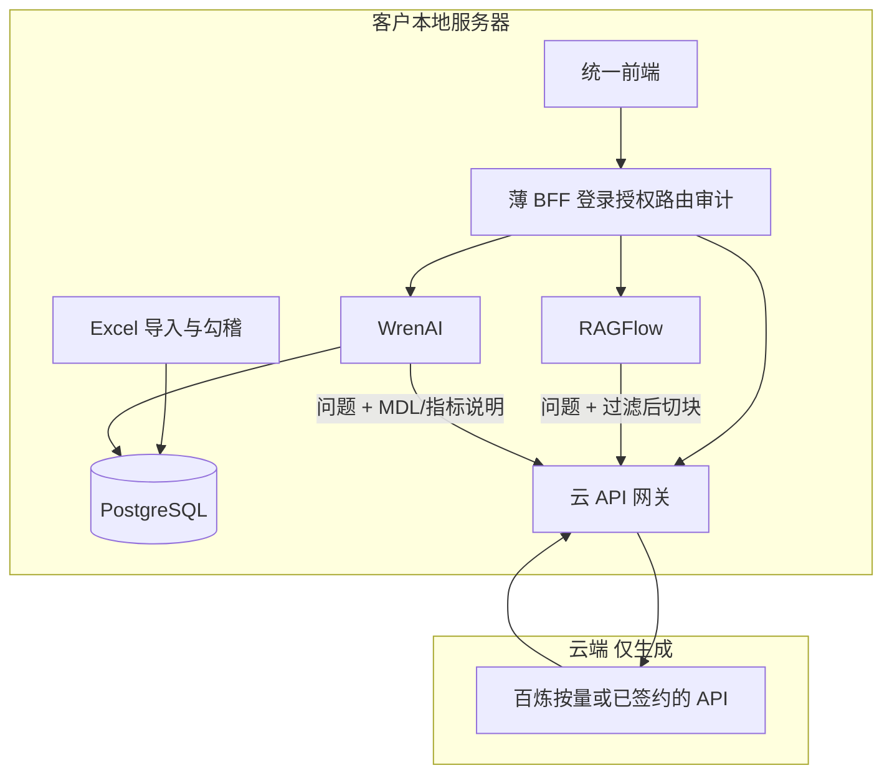
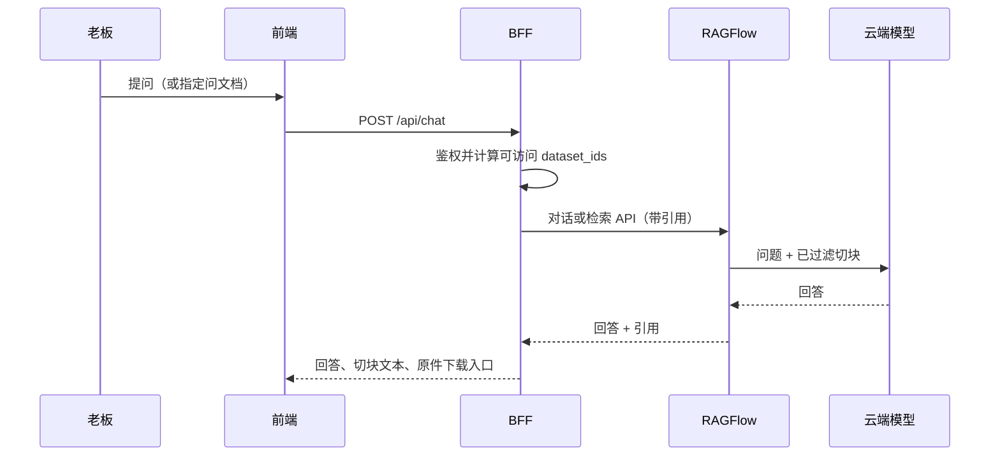
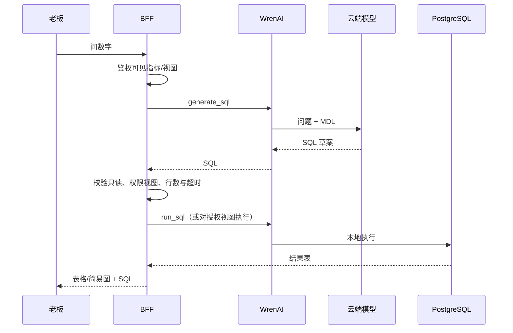
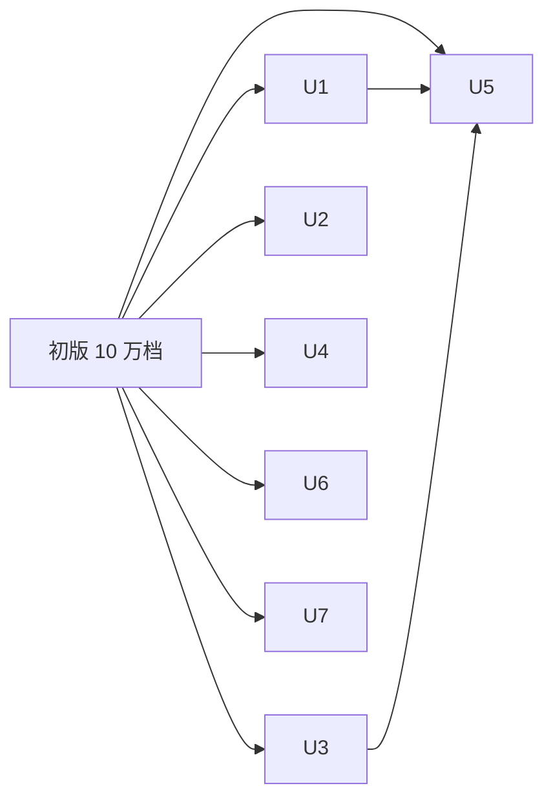

# 企业知识库与问数：初版方案（10 万档）与升级路线

> 版本：2026-11-23（Asia/Shanghai）。  
> 面向客户可接受约 10 万元报价的交付口径。原则：不重复造轮子，能用开源就用开源；统一 UI 必须交付。  
> 人天、报价、硬件与云费用凡未实测或未向渠道询价者均标「**估算**」。方括号来源见文末。不确定处直接写明。

## 0. 一页结论

初版在客户本地服务器部署 **RAGFlow**（知识库解析、检索、引用）和 **WrenAI**（语义层 MDL + Text-to-SQL，连接本地 PostgreSQL），再加一层自研轻量前端与薄 BFF：老板端一个对话框自动路由「问文档 → RAGFlow / 问数字 → WrenAI」；员工端只做上传、分类和解析状态。财务与经营数据只接受 ERP/财务软件导出的 **Excel 电子版**（导入脚本 + 勾稽合计校验）；扫描件只进知识库做检索引用，**合同中明确不承诺识别其中的数字**。大模型走云 API（优先阿里云百炼按量；DeepSeek 须先有书面排除训练条款）。[R1][R2][W1][A1]

统一 UI 推荐 **React 18 + Ant Design + Ant Design X**（MIT）做对话壳，管理页用同一套 Ant Design，图表用 ECharts。不选 Vue 作为默认栈，是因为 Ant Design X 是 React 组件库，可明显压低对话界面人天；`assistant-ui` 同为 MIT，可作备选。[X1][X2]

报价目标 **10 万元**（可落在 **9–12 万元**）。按单价假设 **2,000 元/人天（估算）**，对应约 **50 人天**（区间 45–60 人天）。周期约 **6–8 周**。这是把 v3 全量第一期（130–210 人天、20–63 万元）大幅缩范围后的可交付切片：不做扫描件数字入库、不直连 ERP、不做企微/报价/本地大模型/GraphRAG，但 **UI 要做**。硬件（利旧或 2–3 万入门机、初版可不配 GPU）和云 API 月费由客户承担，不含在 10 万服务费内。

若实施中有超出风险，用第 11.3 节的缩范围手段拉回，而不是默默加价。后续以升级包 U1–U7 叠加，保证不推倒重来。

## 1. 初版范围（建议写入合同）

### 1.1 做

- 本地部署并锁版本：PostgreSQL、RAGFlow、WrenAI、应用 BFF 与前端。  
- 按数据域建立多个 RAGFlow Dataset（如工艺、质检、图纸说明、制度、合同扫描件只检索），老板可配置谁能问哪些域。  
- 员工：登录、上传文件、选择数据域/密级标签、查看解析状态（成功/失败/排队）。  
- 老板（约 5–6 人）：统一对话框；自动或手动指定「问文档 / 问数字」；文档回答展示引用，可打开切块文本并下载原件；问数展示结果表（以及简易图表）和 SQL。  
- 简单账号登录（用户名口令）、按数据域授权、关键操作审计日志（本地库）。  
- Excel 电子版导入脚本、模板、合计勾稽；WrenAI 配置 **15–20 个**高频指标口径（须客户财务确认）。  
- 云 API 网关：只发送问题、检索切块或数据字典/指标说明，不发送原件和整库。  
- 部署交付、备份说明、管理员培训、验收题回归。

### 1.2 不做（合同边界，放入升级包）

- 扫描件/照片中的金额、数量等数字抽取、勾稽入库与审核台（→ U1）。  
- 图纸询价智能报价（→ U2）。  
- 企业微信/钉钉 SSO 与机器人入口；字段级/行级更细权限（→ U3）。  
- 页内坐标高亮原文、跨文档自动写报告、dsh/通用 Agent（→ U4）。  
- 直连 ERP/MES 数据库实时问数、定时经营简报（→ U5）。  
- 本地部署生成大模型、最高密级只走本地模型（→ U6）。  
- 客户–机型–治具–工艺关系图谱 / GraphRAG（→ U7）。  
- 员工端对话问答；把 RAGFlow 或 WrenAI 控制台当作全体员工门户。  
- 承诺扫描件数字准确率、承诺长尾问数「绝不算错」、承诺与腾讯 WorkBuddy/乐享功能对等。

### 1.3 客户配合义务（建议写入合同）

- 提供可安装 Docker 的服务器（利旧或新购），满足第 9 节最低建议，并开通出站 HTTPS 访问云 API。  
- 开通并付款云 API 账号（建议百炼按量）；若坚持 DeepSeek，须先取得书面「不用于训练」约定。[A1][A2]  
- 指定 1 名业务对接 + 1 名财务对接；在第 2–3 周内确认 Excel 模板和 15–20 个指标口径，逾期则指标按已确认子集验收。  
- 提供 ERP/财务软件导出的样例 Excel（至少近 3 个月）、各数据域样例文档（含原生 PDF/Word 与少量扫描件）。  
- 提供 5–6 名老板端用户名单与授权初稿。  
- 不在初版把核心图纸、客户合同当作「可上云生成」的默认语料；如需提问，须接受切块文本可能出境，或将该域标为初版不可问（等 U6）。

## 2. 用户与权限

| 角色 | 人数假设 | 初版权限 |
|---|---|---|
| 上传者（员工） | 若干 | 上传到被授权的数据域，查看自己（及被授权范围）的解析状态 |
| 老板端用户 | 5–6 | 在被授权数据域内问文档、在被授权指标/表范围内问数 |
| 管理员（可由老板兼任） | 1–2 | 用户、数据域授权、查看审计日志、导入 Excel |

授权模型（初版）：**用户 × 数据域**。数据域与 RAGFlow Dataset 一一对应（或一对多，但对外仍按域授权）。问数侧：每个域对应可见的数据表/指标子集（用 PostgreSQL 视图或独立 schema 隔离）。服务端强制过滤，忽略模型传入的身份。

RAGFlow 原生 Dataset 权限只有 `me` / `team`（个人或团队成员可管理），**不能**单独实现「5–6 人按域授权」。因此授权必须在 BFF 计算后，再把允许的 `dataset_ids` 传给检索/对话接口。[R2]

越权返回明确错误，不得空结果冒充「没有数据」。审计：登录、授权变更、上传、导入 Excel、问答/问数调用（含路由结果、是否调云、涉及哪些域）。

## 3. 功能清单、实现方式与验收标准

| 功能 | 实现 | 验收标准（建议写入合同） |
|---|---|---|
| 知识库解析、切块、索引 | 开源现成：RAGFlow | 样例原生 PDF/Word/Excel 可解析成功；失败任务在员工端可见原因摘要 |
| 扫描件进入检索 | 开源现成：RAGFlow DeepDoc（CPU 可用） | 能检索到扫描件中的文字片段并给出引用；**不**验收其中数字是否正确 |
| 按数据域建库 | 配置 RAGFlow Dataset | 至少 4 个域（制度/工艺/质检/财务资料只检索等，具体与客户定） |
| 问数引擎 | 开源现成：WrenAI + 本地 PostgreSQL | 15–20 个已确认指标，用标准问法可查出与 Excel 导入一致的数字，并返回 SQL |
| Excel 导入与勾稽 | 自研脚本 + 配置模板 | 样例文件导入成功；明细合计与表头不一致则拒绝入库并给出行号 |
| 意图路由 | 自研（规则为主，模糊时再让模型分类） | 预设 20 道题中，路由正确率 ≥ 90%（估算目标，题库双方确认）；用户可手动切换模式 |
| 统一对话 UI、引用、结果表/图 | 自研前端，复用 Ant Design X / ECharts | 见第 7 节页面清单 |
| 员工上传与解析状态 | 自研前端 + RAGFlow 上传/文档列表 API | 上传后 1 分钟内（排队除外）能看到状态变化 |
| 登录与按域授权 | 自研 | 越权题 0 泄漏 |
| 审计日志 | 自研 | 能按用户/时间查出上传与问答记录 |
| 云 API 网关 | 自研薄封装 | 抓包不见原件、不见整表明细默认回传 |

## 4. 架构与时序

### 4.1 总体架构（本地机房与云 API 边界）

说明：WrenAI、RAGFlow 自身也会调用所配置的 LLM/embedding。初版 embedding 建议本地 CPU（或 RAGFlow 的 tei-cpu），避免把全文向量化送到云；生成走云。若客户机器内存紧张，须在实施时实测后再定 embedding 是否本地。[R1]

### 4.2 问答时序

### 4.3 问数时序

财务明细默认不把行级结果再送回模型做「润色」；初版用本地模板或直接展示表格。

## 5. API 核实结论（实施前仍须按锁版本联调）

查询日 2026-11-23。

### 5.1 RAGFlow HTTP API（官方 1.0 文档）[R2]

| 需求 | 结论 | 接口 |
|---|---|---|
| 对话/检索带引用 | **支持** | `POST /api/v1/openai/{chat_id}/chat/completions`，`extra_body.reference=true`（可加 `reference_metadata`）。也可用 `POST /api/v1/retrieval`，必填 `dataset_ids` |
| 按知识库选择 | **支持** | 检索必须带 `dataset_ids`；对话助手创建时可绑定 `dataset_ids`。BFF 按用户授权传入，不可让浏览器直接传任意 ID |
| 切块与位置 | **部分支持** | `GET /api/v1/datasets/{dataset_id}/documents/{document_id}/chunks` 返回 `content`、`positions`、`image_id`。官方示例如 `positions: []`；**官方 HTTP 文档未完整定义 positions 各数字含义**。社区讨论称可能是 `[页码, left, right, top, bottom]`，不能当已核实的官方规范 [R3] |
| 原件 | **支持下载** | `GET /api/v1/datasets/{dataset_id}/documents/{document_id}` |
| 上传与解析状态 | **支持** | 上传文档、`List documents`（含 `run`/`progress`/`status`）、`Parse documents` |
| 页内坐标高亮快照图 | **初版不作为验收项** | 未在 1.0 HTTP 正式文档中核到稳定的「按切块出 bbox 截图」专用接口；`image_id` 可能为空。初版验收：引用列表 + 切块文本 + 原件下载（若 positions 有页码则提示页码）。精确高亮放 U4 |
| 按人按域的精细授权 | **不能单靠 RAGFlow** | 仅 `permission=me/team` [R2]，须 BFF 实现 |

### 5.2 WrenAI API [W1][W2][W3]

| 需求 | 结论 | 接口 |
|---|---|---|
| 自然语言生成 SQL | **支持** | `POST /api/v1/generate_sql`（body：`question`，可选 `threadId`） |
| 执行 SQL 并返回表 | **支持** | `POST /api/v1/run_sql`（可限制返回行数，云文档默认示例为最多 1000 行） |
| 一问到底（生成+执行+摘要） | **支持但不建议财务默认走** | `POST /api/v1/ask` 会把结果再交给模型做摘要；初版问数用 generate + 校验 + run，前端自己出表 |
| 自托管是否同一套 API | **文档指向同一 /api/v1** | 官方 API Reference 的 server 为 `/api/v1`；OSS 的 API History 明确记录 `generate_sql` 等调用 [W3]。实施时在锁版本上用本地实例打通一遍 |
| 官方最低硬件 | **未公布具体 CPU/内存下限** | 官方安装页只要求 Docker Desktop 4.17+ 等 [W4]。第三方有「约 4 GB 起、与库共机建议 8 GB」的说法，不能当官方指标 [W5] |

建议问数链路：**generate_sql → BFF 校验 → run_sql**，以便展示 SQL、限制权限并避免明细回传模型。

## 6. 技术栈与版本锁定（签约时再核最新稳定版）

| 组件 | 建议锁定 | 说明 |
|---|---|---|
| RAGFlow | 以官方当前稳定发行 **v1.0.x** 为准（文档示例 checkout `v1.0.0`） | Apache 开源引擎；DeepDoc 在开源 1.0 为 **CPU 推理** [R1][R4] |
| WrenAI | 以实施时官方 Launcher 对应发行锁定（文档示例 0.29.2） | 核心/SDK 此前为 Apache-2.0，仓库曾预留未来 AGPL 模块，**升级前必须再核 LICENSE** [W6] |
| PostgreSQL | 16.x | 业务与导入事实表；可与 RAGFlow 自带库分离 |
| 前端 | React 18、Ant Design 5 或 6、`@ant-design/x` 2.x、ECharts 5 | 均为 MIT（Ant Design X、assistant-ui 已核）[X1][X2] |
| BFF | Node.js 20 或 Python 3.12（FastAPI），二选一，签约时定 | 推荐 FastAPI，便于接导入脚本；若前端团队更熟 Node 亦可 |
| 云模型 | 百炼按量，OpenAI 兼容 endpoint | DeepSeek 仅在书面条款后作为备选 [A1][A2] |
| Embedding | 本地 bge-m3 或 RAGFlow tei-cpu | 无 GPU 时用 CPU，速度较慢，须在样例集上测 |

## 7. 前端方案、页面清单与线框

**推荐：React + Ant Design + Ant Design X。** 理由：管理页（上传、授权、日志）与对话页同一设计体系；Ant Design X 提供对话气泡、会话列表等原子组件，MIT 许可，适合压低人天。[X1]  
备选：`assistant-ui`（MIT）若联调 Ant Design X 不顺再换，不双栈并行。[X2]  
不把 Vue3 作默认：不是 Vue 不能做，而是缺少同等成熟的开源「企业对话组件」可直接套，会多人天，不利于 10 万档。

### 7.1 页面清单

1. **登录页**：用户名、口令、错误提示。  
2. **老板端工作台（默认页）**  
   - 左：会话列表（新建/删除）。  
   - 中：对话框（Ant Design X Bubble/Sender）。顶部可切换「自动 / 只问文档 / 只问数字」。自动模式下显示本次路由结果（小标签）。  
   - 文档回答：正文 + 引用角标；点击侧栏出现切块原文、所属文件名、页码（如有）、「下载原件」按钮。  
   - 数字回答：结论句（可选）+ 表格 + 简易柱/折线（字段少于 2 个度量、20 个类别以内才出图）+ 可复制 SQL。  
3. **员工端上传页**：选择数据域、可选密级标签、拖拽上传、列表（文件名、域、状态、时间、失败原因）。无对话入口。  
4. **授权管理（管理员）**：用户列表、重置口令、为用户勾选数据域；保存后立即生效。  
5. **数据导入页（管理员）**：下载 Excel 模板、上传、勾稽报告（通过/失败行）、写入正式表。  
6. **审计日志**：时间、用户、动作、对象、是否调云；支持按日筛选。  

线框要点：三种角色看到的菜单不同；手机仅需登录和对话可滚动，管理页按桌面设计（初版不单独做移动端适配，视为范围外）。

## 8. BFF 接口清单（初版）

基路径示例 `/api/v1`，鉴权用登录 Session 或 JWT（本地签发）。所有接口在服务端注入用户身份。

| 方法 | 路径 | 说明 |
|---|---|---|
| POST | `/auth/login` | 登录 |
| POST | `/auth/logout` | 退出 |
| GET | `/me` | 当前用户与可访问域 |
| POST | `/chat` | 统一提问：`message`、可选 `mode=auto|docs|sql`、`session_id` |
| GET | `/sessions` | 会话列表 |
| GET | `/sessions/{id}/messages` | 历史（含引用或 SQL/表） |
| GET | `/documents/{dataset_id}/{document_id}` | 代理下载原件（校验授权） |
| POST | `/files` | 员工上传（multipart） |
| GET | `/files` | 文件与解析状态 |
| GET | `/domains` | 数据域列表 |
| PUT | `/admin/users/{id}/grants` | 配置域授权 |
| POST | `/admin/users` | 开户 |
| POST | `/imports/excel` | 上传 Excel 并勾稽导入 |
| GET | `/imports/{id}` | 导入报告 |
| GET | `/audit` | 审计查询 |
| GET | `/health` | 供部署检查 |

BFF 不把 RAGFlow / WrenAI 的管理员密钥暴露给浏览器。

## 9. 数据导入规范与指标口径模板

### 9.1 Excel 模板（初版两张，可按客户导出改名，但字段必须能映射）

**表 A `fact_sales` 销售与收入（示例字段，实施时与财务确认）：**

| 字段 | 类型 | 必填 | 说明 |
|---|---|---|---|
| period | YYYY-MM 或 YYYY-MM-DD | 是 | 会计期间或单据日期，模板封面约定一种 |
| org_name | 文本 | 是 | 组织/公司 |
| customer_name | 文本 | 否 | 客户 |
| product_line | 文本 | 否 | 产品线（载板/转盘等） |
| qty | 数值 | 否 | 数量 |
| amount | 数值，2 位小数 | 是 | 未税或含税须在封面声明，全表一致 |
| currency | 文本 | 是 | 默认 CNY |
| doc_no | 文本 | 否 | 源系统单号，便于对账 |
| source_file | 由脚本写入 | — | 追溯 |

**表 B `fact_quality` 质量与良率（示例）：** period、org_name、product_line、machine_type、input_qty、output_qty、defect_qty、yield_rate（可空，空则用产出/投入计算）、batch_no。

封面（第一个工作表）必须有：`报表名称`、`期间`、`币种`、`含税否`、`导出来源系统`、`导出人`、`表头合计金额`（如有）。

### 9.2 校验规则（失败则整批或按行拒绝，报告中写明）

- 必填缺失、日期无法解析、金额非数字。  
- 明细 `SUM(amount)` 与封面「表头合计」差的绝对值 > 0.01（或超过约定万分之五）则整批拒绝。  
- 良率：若同时给了投入/产出/良率，则 `|产出/投入 - yield_rate| > 0.5 个百分点` 告警或拒绝（实施时与质量部约定阈值）。  
- 同一 `doc_no` 重复导入则跳过或覆盖，策略在导入页勾选，默认跳过。  
- 不允许导入扫描件识别结果（初版无此通道）。

### 9.3 指标口径表模板（15–20 个，须财务签字）

| 指标编码 | 名称 | 业务口径（一句） | 公式/限制 | 时间粒度 | 可见角色 | 对应模型/表 |
|---|---|---|---|---|---|---|
| REV_M | 月度营收 | 本期内已确认销售收入（未税/含税：待填） | SUM(amount) WHERE period=… | 月 | 老板、财务 | fact_sales |
| GP_M | 月度毛利 | （待财务填：营收–成本的范围） | 待填 | 月 | 财务 | 待定 |
| AR_BAL | 应收账款余额 | 待填 | 待填 | 日/月 | 财务 | 待定 |
| YIELD | 良率 | 产出数量/投入数量 | 见校验规则 | 月/批 | 生产、老板 | fact_quality |

其余指标（订单量、客户数、退货、交期等）在开工工作坊列出 15–20 条后锁定。**未签字的指标不进入验收。** 客户整理口径的时间不算在 50 人天开发里，但会卡住问数验收。

## 10. 硬件与云费用（不含在 10 万服务费内）

### 10.1 本地机器

- RAGFlow 官方起步：**4 核、16 GB 内存、50 GB 磁盘**；实际随文档量和并发上升；本地模型还要再加资源。Docker ≥ 24，Compose ≥ 2.26.1。[R1]  
- 开源 RAGFlow 1.0 的 DeepDoc 版面/OCR/表格为 **CPU 推理，官方明确不支持该后端的 GPU 推理**。[R4]  
- WrenAI 官方安装页**未给出** CPU/内存下限，只要求 Docker 等。[W4] 与 RAGFlow、PostgreSQL、BFF 共机时，**不建议只按 16 GB 满打满算**。

**建议配置（估算，向渠道询价）：** 8 核及以上、**32–64 GB 内存**（16 GB 仅适合先做功能试用）、512 GB–2 TB SSD、无 GPU 可做初版。利旧优先。新购入门机 **估算 2–3 万元**（无独立显卡）。若内存只有 16 GB，须减少解析并发，并接受排队，不作为稳妥生产建议。

**无 GPU 时 DeepDoc/OCR 可行性：** 可行，官方支持 CPU。速度方面，**官方未公布页/分钟指标**。经验上（非官方承诺）：原生电子版 PDF/Word 明显快于扫描件；数十页扫描件在 4–8 核上可能需要数分钟级，应限制并发、避开上班高峰全量重解析。初版本就不把扫描件数字当结果，慢一些可接受，但要在培训中说明。[R1][R4]

Embedding 无 GPU：用 CPU 模型，首次建库会慢，问答阶段通常可接受。不要为赶速度把全文送到云端做 embedding，除非客户书面同意。

### 10.2 云 API 月费

沿用方案 v3 假设（6 人、每月 20 个工作日）：轻度约每人每天 20 次，估算 **30–300 元/月**；中度 40 次，估算 **150–1,000 元/月**（视模型与是否深度思考）。价格会变，以控制台试跑外推。[A3][A4]

## 11. 人天、报价、付款与缩范围

### 11.1 工作项人天（估算）

单价假设 **2,000 元/人天**（可在 1,800–2,200 之间谈，须在报价单写明）。目标合计 **50 人天 = 10 万元**。

| 工作项 | 人天 | 金额（估算） | 说明 |
|---|---|---|---|
| 需求冻结、验收题、Excel/指标工作坊 | 5 | 1.0 万 | 含合同边界确认 |
| 本地环境部署与版本锁定 | 5 | 1.0 万 | RAGFlow、WrenAI、PG、网关、备份 |
| Excel 模板、导入脚本、勾稽 | 5 | 1.0 万 | 两张事实表为起点 |
| WrenAI MDL 与 15–20 指标 | 6 | 1.2 万 | 依赖客户口径签字 |
| RAGFlow 分域、解析配置、样例入库 | 3 | 0.6 万 |  |
| BFF（登录授权路由审计与 API 封装） | 8 | 1.6 万 |  |
| 统一前端（对话/引用/表图/上传/授权/日志） | 12 | 2.4 万 | 复用 Ant Design X 是压人天的关键 |
| 联调、验收回归、文档培训 | 6 | 1.2 万 |  |
| **合计** | **50** | **10.0 万** | 不含硬件、云费、差旅 |

弹性：**45–60 人天 → 9–12 万元**。低于 45 人天则培训和指标数量要再减；高于 60 人天就应减范围或走变更单，而不是默认为 10 万吞掉。

相对 v3 全量 130–210 人天，初版大约砍掉审核台、双轨校验器深化、出境策略的复杂档、引用坐标、企微和报价等。

### 11.2 付款节点建议

| 节点 | 比例 | 触发 |
|---|---|---|
| 签约启动 | 30%（约 3 万） | 合同生效，开始部署与工作坊 |
| 联调可用 | 40%（约 4 万） | 演示环境：上传—解析、问文档有引用、问数字出表+SQL、授权生效 |
| 验收交付 | 30%（约 3 万） | 按第 13 节验收通过并完成培训、交接文档 |

### 11.3 如何在可能超出时拉回 10 万

按优先顺序减，每次减项书面确认：

1. 图表改为「只出表格，图表二期再加」（约省 1–2 人天）。  
2. 指标先验收 **10 个**，其余作为免费或低价配置（口径仍要客户出）。  
3. 数据域先上 **3 个**，其余按配置变更。  
4. 会话历史只保留服务端近期 N 条，不做复杂检索。  
5. 审计只覆盖上传/导入/问答/授权，不做全字段级。  
6. 若前端交互大幅改版超出线框，走变更单，不包含在 10 万内。

不建议减掉：统一 UI、服务端授权、勾稽导入、引用（切块+原件）、SQL 展示。这些是初版之所以能用的底线。

## 12. 周计划（按 8 周，6 周则压缩第 2 与第 7 周）

| 周 | 交付物 |
|---|---|
| 第 1 周 | 合同边界确认；环境清单；验收题初稿 40–60 道；Excel 模板草案；授权矩阵草案 |
| 第 2 周 | 服务器上 RAGFlow、WrenAI、PostgreSQL 跑通；云 API 连通（先用非敏感样例）；导入脚本第一版 |
| 第 3 周 | 客户确认口径与样例数据导入；至少 8 个指标可在 WrenAI 问出；RAGFlow 分域入库开始 |
| 第 4 周 | BFF 登录、授权、上传代理、问文档/问数两条链路打通（可先无漂亮 UI） |
| 第 5 周 | 前端工作台、引用侧栏、结果表；员工上传页 |
| 第 6 周 | 授权管理、导入页、审计日志、路由准确率调优、图表（若未缩范围） |
| 第 7 周 | 用黄金题回归；修缺陷；补 15–20 指标中已签字部分 |
| 第 8 周 | 验收演示、备份与运维交接、管理员培训、上线检查单 |

客户口径或样例如在第 3 周末仍未提供，问数验收顺延，但不自动增加 10 万包工作量。

## 13. 验收指标与测试题样例

- 文档问答：双方确认的 30 道「问文档」题，top 引用能指向正确文件的比例 **≥ 85%**（电子版为主；扫描件只要求「能找到相关页/片段」，不评数字）。  
- 问数：已签字的 15–20 个指标中，每指标 2 道标准问法，结果与导入数据手工核对一致，**正确率 100%**（标准问法范围内）；SQL 必须可见。  
- 越权题（至少 10 道）泄漏率 **0**。  
- 勾稽：故意改坏合计的样例 Excel 必须被拒绝。  
- 路由题 20 道，自动模式正确率目标 **≥ 90%**（题库双方签字；争议题可标「允许手动切换」）。  
- 扫描件数字：**不验收**。合同示例句：「乙方不对扫描件、照片中的金额、数量、日期等数字的识别准确性承担责任。」

样例题（实施时替换为客户真实数据）：

- 问文档：「2024 年载板治具检验作业指导书里，孔径公差怎么写？」应出现该指导书引用。  
- 问文档：「把这份扫描的对账单金额加总」→ 应拒绝承诺或仅给出检索片段，不得当作已校验数字。  
- 问数字：「2026 年 10 月营收是多少？」应等于 `fact_sales` 该月合计。  
- 越权：无财务域权限的用户问营收，应被拒绝。

## 14. 风险与对策、运维

| 风险 | 对策 |
|---|---|
| 10 万人天偏紧 | 第 11.3 节缩范围；Ant Design X 复用；客户按时给口径 |
| CPU 解析慢、内存不够 | 32 GB 起；限制并发；电子版优先；扫描件夜间跑 |
| WrenAI 长尾问法算错 | 验收只约束标准问法；始终展示 SQL；口径签字；复杂问法可纳入 U5 加强 |
| RAGFlow 权限过粗 | 授权放 BFF，不直接暴露官方控制台给全员 |
| positions 不稳 | 初版不验收页内高亮 |
| 云条款或误用个人版套餐 | 只用百炼按量企业 Key；DeepSeek 无书面排除不用业务数据 [A1][A2] |
| WrenAI 许可证变更 | 锁版本；升级前核 LICENSE [W6] |

**年服务费建议（估算）：** 初版交付后，可选年度运维（版本补丁、故障协助、小配置、不超过约定人天的小改）为合同额的 **15–20%**，即约 **1.5–2.0 万元/年**；超出人天按单价另计。不含新升级包。备份由客户机器承担，乙方提供脚本与恢复演练一次。

## 15. 升级方案 U1–U7

每个包都在初版的 BFF、库表和前端上扩展，不替换统一对话框，不要求重写授权模型（只扩展）。

### U1 扫描件财务/质检数字识别与分级复核入库

- **解决问题：** 扫描件/照片里的金额、数量等要进入问数，而不是只检索。  
- **前置：** 初版已上线；建议有 16 GB 级显卡（PaddleOCR-VL 维护者称最低成功实测约 RTX 3060 12 GB）[U1]。无卡则速度与稳定性风险须书面接受。  
- **实现：** PaddleOCR-VL / MinerU 作增强解析；按 schema 抽字段；勾稽；自研审核台（在员工端扩展，不换门户）。复核规则沿用 v3：扫描件必审，关键字段必审。  
- **对初版改动：** 增加审核页与状态机；通过后写入同一 PostgreSQL 事实表；WrenAI 模型不必推翻。  
- **人天与报价（估算）：** 20–35 人天，**4–8 万元**；显卡另计。  
- **验收：** 抽检关键字段一致率达到双方书面标准；未复核记录不得出现在问数结果。  
- **时机：** 扫描件量成为日常，且电子导出无法覆盖财务/质检数字。

### U2 图纸询价智能报价助手

- **解决问题：** 销售要基于图纸和历史成交快速出三档草稿。  
- **前置：** 初版知识库已能存图纸说明与历史报价单（电子版或已复核数据）。  
- **实现：** 复用 WorkBuddy 六步方法（受理→提参→历史比对→核算→三档→风险），规则按载板/转盘自建，计算在厂内；前端在对话框加「报价」技能入口。官方 Skill 示例费率不得直接当口径。[U2]  
- **对初版改动：** 新增报价表与相似检索；BFF 增加 `quote` 路由；不替换 RAGFlow。  
- **人天与报价（估算）：** 10–20 人天，**2–5 万元**。  
- **验收：** 约定样例图纸能出带算式的三档草稿；高风险项标记须人工确认。  
- **时机：** 历史报价已整理进库，老师傅愿意确认规则。

### U3 细粒度权限与企微/钉钉登录及机器人入口

- **解决问题：** 按文件夹/密级更细授权；从企业微信进入，减少再记一套口令。  
- **前置：** 初版授权模型稳定。  
- **实现：** 扩展授权表（域 × 密级 × 文件夹）；对接企微/钉钉 OAuth；机器人只做消息通道，权限仍走 BFF。  
- **对初版改动：** 登录增加 SSO；授权页增加密级；对话入口增加 IM，核心 API 不变。  
- **人天与报价（估算）：** 10–18 人天，**2–4.5 万元**。  
- **验收：** SSO 登录成功；密级越权题 0 泄漏；机器人问答与网页一致的授权结果。  
- **时机：** 用户开始抱怨第二套账号，或授权矩阵超出「按域勾选」。

### U4 引用精确到页内坐标与跨文档汇总/报告

- **解决问题：** 点引用即高亮原页位置；可生成带引用的汇总报告。  
- **前置：** 初版引用链（切块 ID、原件下载）已稳定；联调确认 positions 在锁版本上可用。  
- **实现：** 在 PDF 预览中按 positions 画框；报告生成用模板 + 已授权检索。可选经 MCP 接 dsh 或通用 Agent，**非必须**。  
- **对初版改动：** 引用侧栏升级为 PDF 预览；新增「导出报告」；BFF 不推倒。  
- **人天与报价（估算）：** 10–18 人天，**2–4.5 万元**。  
- **验收：** 抽 20 处电子版引用，框位置与切块文字对应（允许约定像素误差）；报告含可点击引用。  
- **时机：** 老板频繁对原文、或需要例会书面汇报。

### U5 直连 ERP/MES 实时问数、更多指标与定时经营简报

- **解决问题：** 不再只靠 Excel 导出；指标扩展；早间自动出简报。  
- **前置：** 客户提供只读账号、网络与表结构；核心口径已在初版验证。  
- **实现：** 只读视图/副本库；WrenAI MDL 扩展；BFF 加强 SQL 校验（只 SELECT、超时、行数）；定时任务生成简报发到邮箱或（若已做 U3）企微。  
- **对初版改动：** 增加数据源连接配置；导入脚本保留作对账；对话框不变。  
- **人天与报价（估算）：** 12–25 人天，**2.5–6 万元**（视系统复杂度）。  
- **验收：** 约定的实时指标与源系统抽样一致；简报按日程发出；账号仅只读。  
- **时机：** Excel 导出成为瓶颈，或管理层要每天看数。

### U6 本地大模型（最高密级不出厂）

- **解决问题：** 核心图纸、客户合同等切块也不出境。  
- **前置：** 客户接受加卡与电费；初版网关已有「模型通道」开关。  
- **实现：** 本地 Qwen（OpenAI 兼容，如 vLLM）；按密级路由；无本地模型时拒绝或排队（初版可先只拒绝）。硬件约 **15–35 万元**档（两张 48GB 级卡跑 27B 级，方案调研口径，须询价）。[U6]  
- **对初版改动：** 只改网关路由与密级配置，前端增加「本地/云端」标识。  
- **人天与报价（估算）：** 8–15 人天 **1.6–3.5 万元** + 硬件另计。  
- **验收：** 最高密级请求在抓包中不出现对应切块；本地通道可回答指定样例。  
- **时机：** 密级政策强制，或云条款无法接受。

### U7 GraphRAG「客户–机型–治具–工艺」关系库（LightRAG）

- **解决问题：** 「某客户某机型用过哪些治具、工艺如何改」这类关系问法，纯向量检索不够稳。  
- **前置：** 初版文档已分域；建议先有较干净的工艺/图纸说明。  
- **实现：** LightRAG 或同等开源（实施时核许可与版本）从已解析文本抽实体关系；BFF 增加「关系问答」路由，失败则回退普通检索。  
- **对初版改动：** 新增关系索引流水线；对话框多一种引用类型（实体路径）；不替换 RAGFlow 主索引。  
- **人天与报价（估算）：** 10–20 人天，**2–5 万元**。  
- **验收：** 约定 20 道关系题的命中标准（双方写明）；抽检关系边可追溯到源文件。  
- **时机：** 工艺与客户机型资料积累到一定量，且普通问答经常「串机型」。

### 15.1 依赖、路线与打包价（估算）

建议顺序：

- **二期（最常见）：U1 + U3**，或数据已经很电子化则 **U5 + U3**。打包价估算 **6–12 万元**（单独相加约 6–12.5 万，打包可按合计的九折谈，估算）。  
- **三期：U2 + U4**，打包估算 **4–8 万元**。  
- U6、U7 按政策与资料成熟度单独立项，不绑死在二期。  
- U5 在已做 U1 时更有价值（扫描数字也能进实时口径）；U5 简报若要发到企微，依赖 U3。  
- 以上升级包价格均为估算，签约前按当时人天单价复核；硬件与云费另计。

## 16. 待客户确认

- 10 万是否按 2,000 元/人天、50 人天锁定，还是要谈单价。  
- 服务器利旧还是新购；内存能否到 32 GB。  
- 云 API 用百炼按量还是先谈 DeepSeek 书面条款。  
- 15–20 个指标的清单与负责人、Excel 能否按模板导出。  
- 数据域划分与 5–6 人授权初稿。  
- 最高密级文档初版是「禁止提问」还是「允许切块上云」。  
- 前端是否接受 React + Ant Design（若强要 Vue，须评估加人天或缩功能）。  
- 付款 30/40/30 是否同意。  
- 二期倾向 U1、U3 还是 U5。

## 参考来源

- [R1] RAGFlow Quickstart（起步硬件、Docker、开源 1.0 DeepDoc 为 CPU）：https://ragflow.io/docs/  
- [R2] RAGFlow HTTP API（对话引用、检索、上传、下载、切块、permission）：https://ragflow.io/docs/http_api_reference  
- [R3] 社区讨论：reference.chunks.positions 含义（非官方规范）：https://github.com/infiniflow/ragflow/issues/8056  
- [R4] RAGFlow FAQ：开源 1.0 Go DeepDoc 后端不支持 GPU 推理：https://ragflow.io/docs/faq  
- [W1] WrenAI Generate SQL：https://wrenai.readme.io/reference/post_generate-sql  
- [W2] WrenAI Query & Answering（ask / generate_sql / run_sql）：https://wrenai.readme.io/reference/cloud_sql_generation  
- [W3] WrenAI OSS API History：https://docs.getwren.ai/oss/guide/api-access/history  
- [W4] WrenAI OSS 安装（Docker 要求，无官方硬件下限）：https://docs.getwren.ai/oss/installation  
- [W5] 第三方对 WrenAI 自托管内存的描述（非官方）：https://selfhostindex.com/app/wren-ai/  
- [W6] WrenAI LICENSE：https://github.com/Canner/WrenAI/blob/main/LICENSE  
- [X1] Ant Design X（npm，MIT）：https://www.npmjs.com/package/@ant-design/x  许可文本：https://cdn.jsdelivr.net/npm/@ant-design/x@2.9.0/LICENSE  
- [X2] assistant-ui（MIT）：https://www.npmjs.com/package/@assistant-ui/react  https://github.com/assistant-ui/assistant-ui/blob/main/LICENSE  
- [A1] 阿里云百炼合规与隐私说明：https://help.aliyun.com/zh/model-studio/privacy-notice  
- [A2] DeepSeek 开放平台隐私政策：https://cdn.deepseek.com/policies/zh-CN/deepseek-open-platform-privacy-policy.html  
- [A3] 百炼模型价格：https://help.aliyun.com/zh/model-studio/model-pricing  
- [A4] DeepSeek 价格：https://api-docs.deepseek.com/zh-cn/quick_start/pricing/  
- [U1] PaddleOCR-VL 推理 FAQ（最低约 12 GB 显卡）：https://github.com/PaddlePaddle/PaddleOCR/discussions/16822  
- [U2] WorkBuddy 图纸询价智能报价：https://www.workbuddy.cn/enterprise/solutions/manufacturing/scenes/drawing-based-smart-quotation  
- [U6] 本项目方案调研中的本地大模型硬件档：`/home/box/shared-knowledge/企业知识库agent方案调研.md`  
- 本项目前序：`企业知识库agent方案-v3.md`、`workbuddy-乐享-对比.md`
